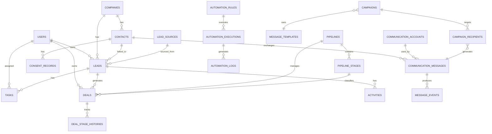

# AGENT.md — B2B Outreach CRM

> **Dokumen acuan utama untuk AI coding agent** selama development di **laptop lokal**, push ke **GitHub**, dan persiapan deploy ke **server LAB-01**.
>
> Baca seluruh dokumen ini sebelum menulis kode. Jika ada instruksi pengguna yang bertentangan dengan dokumen ini, **tanyakan dulu**, jangan memilih sendiri.
>
> **Prinsip utama:** Build dan test di laptop dengan major version runtime yang sama dengan LAB-01. Konfigurasi berbasis environment. Push kode yang sudah teruji. Server hanya target deploy, **bukan** tempat development. Jangan mengubah infrastruktur existing tanpa kebutuhan dan persetujuan eksplisit.

---

## Daftar Isi

0. Protokol Kerja Agent (anti "asal ngoding")
1. Ringkasan Proyek, Scope, Non-goals
2. Stack, Versi, Dependency
3. Aturan Mutlak
4. Setup Lokal & Environment
5. Arsitektur Aplikasi & Struktur Folder
6. Spesifikasi Modul Fungsional
7. Desain Database PostgreSQL (tabel, indeks, ERD)
8. Spesifikasi API Endpoint
9. Integrasi Email (Google Workspace + Gmail API)
10. Integrasi WhatsApp (Evolution API + Baileys)
11. Communication Manager (kontrak provider, config, eligibility gate)
12. Queue, Scheduler, Reliability, Race Condition
13. Security
14. UI/UX: Anti "AI Slop", Taste Skill, Design System
15. Testing: Unit/Feature + Playwright E2E
16. Analytics & KPI
17. Git & Workflow
18. Roadmap Implementasi & Milestone
19. Checklist Sebelum Push
20. Konteks Server LAB-01 & Deployment (informasi, bukan untuk diubah)
21. Monitoring, Backup, Risiko
22. Item Belum Terkonfirmasi
23. Definition of Done & Keputusan Arsitektur Final

---

## 0. Protokol Kerja Agent (anti "asal ngoding")

### 0.0 Mode Operasi Agent

Agent harus membedakan jenis instruksi pengguna:

**A. Read-only / Context Loading**
Contoh:
- Baca AGENT.md.
- Pelajari arsitektur project.
- Pahami struktur folder.
- Audit kode tanpa melakukan perubahan.
- Pelajari dokumentasi sebelum task berikutnya.

Aturan:
1. Selesaikan pembacaan sesuai scope yang diminta.
2. Jangan meminta approval hanya karena membaca dokumentasi.
3. Jangan membuat rencana implementasi jika belum diminta.
4. Jangan mengubah file, konfigurasi, database, atau environment.
5. Berikan ringkasan pemahaman, batasan penting, dan informasi yang belum terverifikasi.
6. Setelah selesai, nyatakan siap menerima instruksi berikutnya.

**B. Implementation**
Jika pengguna meminta implementasi, ikuti §0.1 sampai §0.4.

**C. Audit / Investigation**
Jika pengguna meminta audit atau investigasi, periksa bukti aktual dan berikan temuan tanpa mengubah sistem, kecuali perubahan secara eksplisit diminta.

**D. High-risk Operations**
Kondisi yang tercantum di §0.3.1 dan §3 tetap wajib meminta persetujuan. Aturan ini tidak boleh dilewati oleh instruksi mode lain.

**General Rule:**
Jangan berhenti hanya karena pekerjaan memerlukan analisis. Selesaikan seluruh pekerjaan yang berada dalam scope dan kewenangan yang diberikan. Bertanya hanya jika ada keputusan penting yang benar-benar membutuhkan input pengguna.

### 0.1 Sebelum menulis kode
1. Baca `AGENT.md` ini dan `docs/` (jika ada). Identifikasi **tahap** (§18) dan **modul** yang disentuh.
2. Tulis rencana singkat: file yang akan dibuat/diubah, migration, test, dan dampaknya ke modul lain. Untuk perubahan > 3 file atau menyentuh database/consent/queue, **minta persetujuan rencana** dulu.
3. Periksa kode existing (`rg`, `git log`, `git status`) sebelum membuat file baru. Jangan menduplikasi class/service yang sudah ada.
4. Jika kebutuhan ambigu atau item ada di §22 (belum terkonfirmasi): **bertanya**, atau pakai placeholder via `.env` dan catat sebagai pertanyaan terbuka. Jangan menebak.

### 0.2 Larangan halusinasi
- **Jangan mengarang** nama package, method, endpoint, versi, atau opsi konfigurasi. Verifikasi dulu: `composer show`, `composer why-not`, `php artisan list`, `php artisan route:list`, dokumentasi resmi versi yang terpasang.
- Laravel 13 dan Livewire 4 adalah versi baru: **jangan memakai sintaks Laravel 10/11 atau Livewire 2/3 dari ingatan**. Cek dokumentasi versi terpasang dan `vendor/` bila ragu.
- API **Evolution API** berbeda antar versi image. Cek dokumentasi versi yang di-pin sebelum menulis client; jangan menebak path atau payload.
- Jika sebuah fitur tidak bisa diverifikasi, katakan terus terang dan beri opsi, jangan menulis kode yang "kelihatannya benar".

### 0.3 Saat menulis kode
- Satu perubahan = satu tujuan. Commit kecil dan deskriptif.
- Ikuti struktur domain (§5). Business logic di Action/Service, bukan di Livewire/Controller/Job.
- Setiap perubahan schema = migration. Setiap rule bisnis kritis = test.
- Jangan menambah dependency tanpa alasan; catat alasan, versi, dan kebutuhan ekstensi PHP di PR/commit.
- Jangan hardcode URL, credential, nama DB, domain, port.

### 0.3.1 Berhenti dan tanya jika
- Perlu mengubah stack/versi runtime.
- Perlu menyentuh file/konfigurasi di luar repository (server, Nginx, Redis, Docker host, Cloudflare Tunnel).
- Perubahan akan melemahkan consent gate, suppression, audit log, atau mengaktifkan pengiriman WhatsApp otomatis.
- Perlu migration destruktif (drop column/table, ubah tipe yang kehilangan data).
- Test kritis gagal dan perbaikannya berarti mengubah test, bukan kode.

### 0.4 Sebelum menyatakan "selesai"
Jalankan dan laporkan hasil nyata (bukan asumsi):
```bash
./vendor/bin/pint --test
./vendor/bin/phpstan analyse
php artisan test
npm run build
npx playwright test            # jika menyentuh UI/alur pengguna
```
Laporkan: apa yang diubah, test yang dijalankan beserta hasilnya, dan hal yang belum bisa diverifikasi.

---

## 1. Ringkasan Proyek, Scope, Non-goals

### 1.1 Tujuan
Platform internal untuk mengelola prospek B2B: import & validasi, dedup, segmentasi, consent/suppression, komunikasi email (Gmail API) dan WhatsApp (Evolution API + Baileys, manual), sales pipeline, follow-up, automation rule-based, analytics, audit trail.

Sistem harus mampu:
1. Mengelola 100–500 prospek baru per hari.
2. Mengimpor prospek dari CSV/XLSX.
3. Memvalidasi dan mendeteksi duplikasi kontak.
4. Mengelompokkan prospek (industri, lokasi, kebutuhan, potensi).
5. Menyimpan dasar pemrosesan data dan consent per kanal.
6. Mengelola komunikasi email lewat Gmail API.
7. Mengelola WhatsApp lewat workflow manual + webhook Evolution (inbound).
8. Mengotomatisasi aktivitas sales yang memenuhi syarat.
9. Mengelola pipeline dari lead hingga closing.
10. Menyediakan dashboard dan laporan performa.
11. Menyimpan seluruh riwayat aktivitas dan audit trail.

### 1.2 Arsitektur
**Modular monolith**: satu aplikasi Laravel, tiap domain bisnis punya batas tanggung jawab, service, model, dan proses yang jelas. Lebih sederhana daripada microservices dan tetap memungkinkan menjadi SaaS di masa depan. **Tahap awal = internal sales operating system.** Multi-tenant, subscription billing, SaaS: jangan dibangun sekarang.

### 1.3 Scope modul

| Modul | Fitur | Prioritas |
|---|---|---|
| Authentication | Login, logout, session, reset password | P0 |
| User Management | Role, permission | P0 |
| Lead Management | CRUD, import, export | P0 |
| Lead Intelligence | Scoring, segmentation | P1 |
| Consent Management | Consent, suppression | P0 |
| Campaign Management | Email campaign | P1 |
| Email Integration | Gmail API | P1 |
| WhatsApp Management | Webhook inbound + workflow manual | P1 |
| Sales Pipeline | Deal, stage, activity | P1 |
| Automation Engine | Trigger, condition, action | P2 |
| Follow-up Manager | Task, reminder | P1 |
| Analytics | KPI, funnel, conversion | P2 |
| Reporting | CSV, PDF export | P2 |
| Audit Log | Activity tracking | P0 |

P0 = fondasi wajib, P1 = fitur operasional, P2 = pengembangan lanjutan.

### 1.4 Non-goals (DILARANG dibangun di versi pertama)
- WhatsApp unofficial API untuk **blast/outbound otomatis**.
- Otomatisasi pengiriman WhatsApp melalui browser.
- Pengiriman promosi massal ke kontak tanpa izin.
- Email spoofing atau rotasi akun untuk melewati quota.
- Scraping data pribadi tanpa dasar pemrosesan yang sah.
- AI autonomous agent yang mengirim pesan tanpa persetujuan dan kontrol.

---

## 2. Stack, Versi, Dependency

### 2.1 Stack

| Layer | Teknologi |
|---|---|
| Backend | Laravel 13 |
| Runtime | PHP **8.3.x** |
| UI | Livewire 4 + Blade |
| CSS | Tailwind CSS |
| Interaktivitas | Alpine.js |
| Database | PostgreSQL **16.x** |
| Cache / Queue / Session | Redis **7.x** |
| Queue monitoring | Laravel Horizon |
| Scheduler | Laravel Scheduler |
| Email | Google Workspace + Gmail API + OAuth 2.0 |
| WhatsApp | Evolution API (Baileys), outbound `manual` |
| Auth | Laravel session authentication |
| Authorization | RBAC + Policies/Gates |
| Web server | Nginx + PHP-FPM |
| Process manager | Supervisor |
| E2E test | Playwright |
| Test/QA PHP | Pest/PHPUnit, Laravel Pint, PHPStan/Larastan |

### 2.2 Baseline versi (server LAB-01 vs lokal)

| Komponen | Server LAB-01 | Acuan lokal |
|---|---|---|
| Ubuntu | 24.04.4 LTS | Boleh Windows/macOS/Linux |
| PHP CLI & FPM | 8.3.6 | 8.3.x |
| Composer | 2.10.3 | 2.x |
| Node.js | 22.23.2 | 22.x |
| npm | 10.9.8 | 10.x |
| PostgreSQL | 16.15 | 16.x |
| Redis | 7.0.15 | 7.x |
| Nginx | 1.24 | versi kompatibel |
| Supervisor / Cron | Active | Tidak wajib; scheduler jalan manual |

### 2.3 Ketentuan versi
1. Baseline development dan production: **PHP 8.3**. Jangan pakai fitur khusus PHP 8.4/8.5 (mis. property hooks, asymmetric visibility, `array_find`, dst.).
2. Baseline DB PostgreSQL 16; cache/queue/session Redis 7; build frontend Node 22; Composer 2.
3. Jangan menaikkan versi runtime production hanya agar dependency cocok. Evaluasi dependency dulu.
4. `composer.lock` dan `package-lock.json` **wajib di-commit**.
5. Validasi kompatibilitas sebelum mengunci versi: `composer check-platform-reqs`, matriks kompatibilitas Laravel/Livewire.

### 2.4 PHP extensions (tersedia di server)
`pdo_pgsql, pgsql, redis, bcmath, curl, dom, fileinfo, gd, intl, mbstring, pcntl, zip`

- Semua ekstensi yang dibutuhkan harus tercantum di `composer.json` (`ext-*`).
- **Jangan mengasumsikan ekstensi tambahan tersedia** (mis. `imagick`, `gmp`, `sodium` di luar bawaan, `xml` writer tertentu). Cek dengan `php -m` sebelum bergantung padanya.
- Perhatikan perbedaan ekstensi **PHP CLI vs PHP-FPM**.

### 2.5 Kandidat package (verifikasi dulu sebelum dipasang)
| Kebutuhan | Kandidat | Catatan |
|---|---|---|
| RBAC | `spatie/laravel-permission` | Tabel `roles`, `permissions`, `model_has_roles`, `model_has_permissions` |
| Queue monitoring | `laravel/horizon` | Butuh `pcntl` + `redis` (ada di server) |
| Gmail | `google/apiclient` | Atau HTTP client langsung; pilih satu |
| Import XLSX | `openspout/openspout` atau `maatwebsite/excel` | Pilih yang hemat memori untuk file besar |
| Nomor telepon | `giggsey/libphonenumber-for-php` | Normalisasi E.164 |
| Audit | Implementasi sendiri (`audit_logs`) | Jangan overengineer |
| Test | `pestphp/pest`, `pestphp/pest-plugin-laravel` | |
| Static analysis | `larastan/larastan` | |
| Format | `laravel/pint` | |
| E2E | `@playwright/test`, `@axe-core/playwright` | Lihat §15 |

Ketersediaan ekstensi `gd` dan `zip` mendukung pemrosesan XLSX. Jika paket butuh ekstensi lain, **tanya dulu**.

---

## 3. Aturan Mutlak

### 3.1 Dilarang (tanpa persetujuan eksplisit)
1. Mengubah konfigurasi server dari proses development lokal.
2. Membuat konfigurasi production berdasarkan asumsi (domain, credential, port, nama DB, user Linux, path deploy).
3. Menghapus file, database, volume, atau konfigurasi server.
4. Mengganti teknologi/versi dependency tanpa alasan teknis.
5. Menjalankan `migrate:fresh`, `db:wipe`, `FLUSHALL`, `FLUSHDB` pada environment selain lokal/test.
6. Meng-commit `.env`, token OAuth, API key, private key, QR/session WhatsApp, atau secret lain.
7. Menggunakan database production dari laptop.
8. Force push ke `main`/branch production.
9. Mengerjakan fitur di luar tahap yang sedang berjalan (§18).
10. Membuat kode yang mengirim WhatsApp massal/otomatis atau mengakali kuota Gmail.
11. Melewati consent/eligibility gate, termasuk "sementara untuk testing" di kode produksi.
12. Menjalankan deployment dari working tree yang belum bersih.
13. Mengubah `WHATSAPP_OUTBOUND_MODE` dari `manual`.

### 3.2 Aturan Redis (server berbagi Redis dengan aplikasi lain)
`maxmemory: 0`, `maxmemory-policy: noeviction`. Redis juga dipakai service lain.
1. Jangan `FLUSHALL`/`FLUSHDB` (di lokal pun jangan pada Redis yang dipakai proyek lain).
2. Jangan ubah konfigurasi global Redis.
3. Wajib prefix khusus CRM, mis. `REDIS_PREFIX=crm_internal_`.
4. Pisahkan namespace cache, session, queue (prefix atau DB index berbeda).
5. Jangan mengasumsikan Redis hanya dipakai CRM.

### 3.3 Aturan database
1. DB dan role khusus CRM. **Jangan** pakai `mooja_staging`, `mooja_production`, `postgres`, role `mooja`.
2. Jangan ubah konfigurasi global PostgreSQL untuk CRM.
3. Semua perubahan schema lewat migration; gunakan transaction jika sesuai.
4. Jangan `migrate:fresh`/`db:wipe` di production.
5. Credential DB tidak pernah masuk GitHub.

---

## 4. Setup Lokal & Environment

### 4.1 Service lokal
Pilih salah satu: native (Laragon/Herd/Homebrew/apt) **atau** Docker Compose **lokal** untuk PostgreSQL 16 + Redis 7 (hanya di laptop, tidak berhubungan dengan server).

### 4.2 Verifikasi awal
```bash
php -v                      # 8.3.x
composer -V                 # 2.x
node -v && npm -v           # 22.x / 10.x
psql --version              # 16.x
redis-server --version      # 7.x
php -m                      # cek ekstensi (lihat §2.4)
```

### 4.3 Bootstrap
```bash
composer install
cp .env.example .env
php artisan key:generate
php artisan migrate --seed
npm ci
npx playwright install --with-deps chromium     # sekali saja, untuk E2E
```

Proses lokal: web server (`php artisan serve` / Herd / Laragon), `php artisan horizon` (atau `queue:work`), `php artisan schedule:work`, `npm run dev`.

### 4.4 `.env` lokal
```env
APP_NAME="B2B Outreach CRM"
APP_ENV=local
APP_DEBUG=true
APP_URL=http://crm-internal.test

DB_CONNECTION=pgsql
DB_HOST=127.0.0.1
DB_PORT=5432
DB_DATABASE=crm_internal
DB_USERNAME=crm_local
DB_PASSWORD=

CACHE_STORE=redis
QUEUE_CONNECTION=redis
SESSION_DRIVER=redis

REDIS_HOST=127.0.0.1
REDIS_PORT=6379
REDIS_PREFIX=crm_internal_local_

EMAIL_PROVIDER=gmail                # gunakan "fake" untuk test/E2E
GOOGLE_CLIENT_ID=
GOOGLE_CLIENT_SECRET=
GOOGLE_REDIRECT_URI=http://crm-internal.test/integrations/google/callback

WHATSAPP_PROVIDER=evolution         # gunakan "fake" untuk test/E2E
WHATSAPP_OUTBOUND_MODE=manual       # JANGAN DIUBAH
EVOLUTION_API_URL=
EVOLUTION_API_KEY=
EVOLUTION_INSTANCE=crm-sales-local
EVOLUTION_WEBHOOK_URL=
EVOLUTION_WEBHOOK_SECRET=
```

### 4.5 `.env` production (template, bukan konfigurasi final)
```env
APP_ENV=production
APP_DEBUG=false
APP_URL=https://<domain-production>

DB_CONNECTION=pgsql
DB_HOST=127.0.0.1
DB_PORT=5432
DB_DATABASE=<production_database>
DB_USERNAME=<production_username>
DB_PASSWORD=<production_password>

CACHE_STORE=redis
QUEUE_CONNECTION=redis
SESSION_DRIVER=redis

REDIS_HOST=127.0.0.1
REDIS_PORT=6379
REDIS_PREFIX=crm_internal_production_
```
Credential production dibuat di server. `APP_KEY` production dibuat khusus dan **tidak boleh berubah** antar deploy (data terenkripsi, termasuk token OAuth, tidak terbaca lagi jika key hilang/berubah).

### 4.5.1 Aturan environment
- `.env.example` selalu diperbarui (tanpa nilai rahasia) saat menambah variabel.
- `env()` hanya dipanggil di `config/*.php`; di luar itu pakai `config()`.
- Jangan commit `.env`, token OAuth, credential, private key.
- Jangan menanam konfigurasi lokal secara hardcoded.

---

## 5. Arsitektur Aplikasi & Struktur Folder

### 5.1 Layer
```
Presentation Layer   : Livewire · Blade · Alpine.js · Tailwind CSS
Application Layer    : Controllers · Livewire Components · Actions · Services · Policies
Domain Modules       : Leads · CRM · Sales · Campaigns · Automation
Integration Layer    : Gmail API · Evolution API (WhatsApp) · Import/Export
Data                 : PostgreSQL (primary) · Redis (queue, cache, locks)
Infrastructure       : Nginx · PHP-FPM · Queue Workers · Scheduler · Supervisor · Cloudflare Tunnel
```

### 5.2 Struktur folder
```
b2b-outreach-crm/
├── app/
│   ├── Console/Commands/
│   ├── Domain/
│   │   ├── Identity/        {Models, Actions, Services}
│   │   ├── Companies/       {Models, Actions, Services}
│   │   ├── Leads/           {Models, Actions, Services, DTOs, Events}
│   │   ├── Consent/         {Models, Actions, Services}
│   │   ├── Campaigns/       {Models, Actions, Services}
│   │   ├── Communications/
│   │   │   ├── Contracts/   EmailProvider.php, WhatsAppProvider.php
│   │   │   ├── Email/Gmail/ GmailOAuthService, GmailDraftService, GmailMessageSyncService, GmailProvider
│   │   │   ├── WhatsApp/Evolution/ EvolutionClient, EvolutionWebhookHandler, EvolutionConnectionService, EvolutionProvider
│   │   │   ├── Models/
│   │   │   ├── Services/    CommunicationManager, CommunicationEligibility, MessagePersonalization, SuppressionService
│   │   │   └── DTOs/        EmailMessageData, CommunicationResult
│   │   ├── Sales/           {Models, Actions, Services}
│   │   ├── Tasks/
│   │   ├── Automation/
│   │   ├── Analytics/
│   │   └── Audit/
│   ├── Http/
│   │   ├── Controllers/Api/V1/
│   │   ├── Middleware/
│   │   ├── Requests/
│   │   └── Resources/
│   ├── Livewire/
│   │   ├── Dashboard/ Leads/ Companies/ Contacts/ Campaigns/
│   │   ├── Sales/ Tasks/ Automation/ Analytics/ Settings/
│   ├── Jobs/  Listeners/  Policies/  Providers/  Support/
├── bootstrap/  config/
├── database/{migrations, factories, seeders}
├── docs/{design/DESIGN.md, decisions/, runbooks/}
├── resources/{views/{layouts,components,livewire,emails}, css, js}
├── routes/{web.php, api.php, console.php}
├── storage/
├── tests/{Feature, Unit, Integration, Architecture, e2e}
├── playwright.config.ts
├── composer.json  package.json  .env.example  AGENT.md
```

### 5.3 Aturan arsitektur
1. **Livewire component hanya mengurus interaksi UI.**
2. Business logic di **Action** atau **Service**.
3. Akses database dengan Eloquent atau Query Builder.
4. Semua input divalidasi (Form Request / Livewire validation).
5. Otorisasi lewat **Policy**.
6. Integrasi eksternal **wajib lewat adapter** (interface di `Contracts/`).
7. Job tidak boleh berisi business logic berlebihan (panggil Action/Service).
8. Setiap operasi penting menghasilkan **event** atau **audit record**.
9. Jangan menaruh SQL kompleks di Blade/Livewire view.

Contoh alur:
```
Livewire/Leads/CreateLead.php
        |
        v
Domain/Leads/Actions/CreateLead.php
        |
        v
Domain/Leads/Services/LeadService.php
        |
        v
PostgreSQL
```

### 5.4 Konvensi
- Namespace mengikuti folder domain. Test mencerminkan struktur domain.
- `tests/Architecture` memakai Pest arch test untuk menjaga aturan (mis. `Livewire` tidak boleh langsung memanggil provider eksternal; `Jobs` tidak memanggil model query kompleks).
- Nama permission berbasis aksi (`leads.view`, `leads.import`, `campaigns.approve`, dst., lihat §6.1).

---

## 6. Spesifikasi Modul Fungsional

### 6.1 Authentication, User Management, RBAC

Fitur: login/logout, password reset, aktivasi/deaktivasi user, RBAC, session management, login history, audit log.

| Role | Hak akses |
|---|---|
| Super Admin | Seluruh sistem |
| Admin | User, konfigurasi, integrasi |
| Sales Manager | Semua leads dan pipeline |
| Sales Agent | Hanya leads yang ditugaskan |
| Analyst | Dashboard dan laporan |
| Viewer | Read-only |

Permission berbasis aksi (bukan sekadar menyembunyikan menu frontend):
```
leads.view  leads.create  leads.update  leads.delete  leads.import  leads.export  leads.assign
campaigns.view  campaigns.create  campaigns.approve  campaigns.send
deals.view  deals.create  deals.update  deals.close
automation.manage
analytics.view
users.manage
settings.manage
```
Validasi setiap operasi di server dengan Policy/Gate. Batasi akses berdasarkan ownership dan assignment.

### 6.2 Lead Management (modul inti)

Fitur: create/read/update/archive, import CSV/XLSX, bulk assignment, duplicate detection, lead scoring, filter & saved views, timeline aktivitas, lead ownership, lead source tracking.

Contoh tampilan detail lead (ilustrasi, bukan data nyata):
- Header: nama perusahaan, industri · kota · status website, badge status (mis. Qualified).
- Contact person, lead score (mis. 85/100), email, assigned to.
- Activity timeline: Lead imported → Lead qualified → Email consent verified → menunggu aktivitas outreach.

**Lead lifecycle:**
```
NEW
  |
  v
RESEARCHING
  |
  v
QUALIFIED
  |
  v
ASSIGNED
  |
  v
CONTACTED
  |
  +------> INTERESTED
  |            |
  |            v
  |          MEETING
  |            |
  |            v
  |         PROPOSAL
  |            |
  |            v
  |        NEGOTIATION
  |            |
  |       +----+----+
  |       v         v
  |      WON       LOST
  |
  +------> DISQUALIFIED
```
Status lead **dan** status deal dipisahkan. Satu lead bisa punya beberapa deal. Transisi status harus lewat Action yang memvalidasi urutan yang sah, mencatat activity, dan memicu event.

### 6.3 Lead Import & Validation

Alur:
1. Upload CSV/XLSX.
2. Validasi struktur header.
3. Validasi tipe data.
4. Normalisasi email dan nomor telepon.
5. Deteksi duplikasi.
6. Tampilkan preview.
7. Konfirmasi import.
8. Proses melalui queue (`imports`).
9. Tampilkan hasil import (sukses/gagal/duplikat per baris).

Format minimal:

| company_name | contact_name | email | phone | industry | source |
|---|---|---|---|---|---|
| PT ABC | Budi | budi@abc.id | +62812... | ISP | Referral |
| CV XYZ | Andi | andi@xyz.id | +62813... | Retail | Website |

Aturan dedup:
- Email: lowercase + trim.
- Telepon: format **E.164**.
- Identitas perusahaan: domain + nama ternormalisasi sebagai sinyal pencocokan.
- **Jangan** otomatis menggabungkan dua perusahaan hanya karena nama mirip.
- Duplikasi ambigu → **review queue**.
- Import harus **idempotent**: unggah file yang sama dua kali tidak boleh menghasilkan duplikasi tanpa disengaja (gunakan hash file + `import_batches`/`import_rows`).
- Jangan proses file besar sinkron di request HTTP; pakai chunk/stream untuk hemat memori.

### 6.4 Consent & Suppression

Komponen wajib sebelum campaign/komunikasi diaktifkan. Tiap kanal punya status dan dasar pemrosesan sendiri:
```
EMAIL     : UNKNOWN | GRANTED | REVOKED
WHATSAPP  : UNKNOWN | GRANTED | REVOKED
```
Simpan: source, timestamp, purpose, wording/versi persetujuan, evidence/reference, revocation timestamp.

- Jangan menganggap email bisnis publik atau nomor WhatsApp dari website sebagai consent pemasaran.
- Suppression list diperiksa **global**, bukan hanya per campaign.
- Riwayat consent **append-only**.
- Default **deny** jika status tidak diketahui.

### 6.5 Campaign Management

Fitur: campaign CRUD, type, target segment, message template, preview, approval workflow, eligibility validation, scheduling, delivery tracking, campaign analytics.

```
DRAFT -> REVIEW -> APPROVED -> SCHEDULED -> RUNNING -> COMPLETED
```
Status tambahan: `PAUSED`, `CANCELLED`, `FAILED`. Setiap campaign punya **channel tersendiri**; jangan mencampur aturan eligibility email dan WhatsApp. Pembuat dan approver sebaiknya berbeda user (aturan approval).

### 6.6 Gmail Integration (ringkas; detail di §9)
Connect Google account, OAuth callback, buat draft, kirim email yang sudah disetujui, simpan provider message ID, track error API, sync reply (polling dulu), tangani token expired/refresh, disconnect. Bedakan status `accepted`, `sent`, `bounced`, `failed`, `replied` bila sinyalnya tersedia.

### 6.7 WhatsApp Management (ringkas; detail di §10)
Karena memakai Baileys (tidak resmi): outbound **manual**. Fitur: status koneksi instance, webhook pesan masuk → activity log, tombol buka WhatsApp, pesan ter-personalisasi (draft), sales mengirim sendiri, mencatat hasil komunikasi, menjadwalkan follow-up.

## 6.8 Proposal Generation & Scheduled Delivery

### 6.8.1 Objective

CRM MUST support personalized proposal generation and scheduled delivery through Gmail and WhatsApp.

The feature is named **Proposal Outreach Campaign**.

The system uses imported lead data, reusable HTML proposal templates, generated PDF documents, and editable message templates.

Approved campaigns can automatically deliver proposals to eligible recipients according to configurable business hours and provider-specific rate limits.

This feature is a narrowly scoped exception to the existing Gmail draft-first and WhatsApp manual-outbound policies. It MUST NOT enable general-purpose bulk messaging.

### 6.8.2 Source Template

Initial proposal template:

`public/proposal/contoh_proposal.html`

The coding agent MUST inspect the actual files and assets in this directory before implementation.

The provided Website Sekolah HTML proposal is the initial reference.

Requirements:

- Preserve original visual identity, page structure, A4 layout, typography, spacing, CSS Grid, Flexbox, print styling, and branding.
- Convert the HTML into a reusable, versioned server-side template.
- Prefer Laravel Blade for dynamic rendering.
- Keep master templates outside publicly accessible generated-document storage.
- Preserve or explicitly document required images, fonts, logos, and other assets.
- Do not replace the original design with an unrelated layout.
- Support additional proposal templates in the future.

### 6.8.3 Personalization Variables

Use fields from the existing CRM import template:

| Variable | Source |
|---|---|
| `company_name` | Imported company data |
| `contact_name` | Imported contact data |
| `email` | Imported contact data |
| `phone` | Imported contact data |
| `industry` | Imported lead data |
| `source` | Imported lead data |
| `proposal_number` | Generated uniquely by CRM |
| `proposal_date` | Generated by CRM |
| `sender_name` | CRM sender settings |
| `sender_email` | CRM sender settings |
| `sender_phone` | CRM sender settings |
| `sender_website` | CRM sender settings |

Rules:

- Never invent recipient or company information.
- Do not infer gender or personal titles from names.
- Use a neutral greeting when recipient title is unavailable.
- Validate required variables before generating a proposal.
- Optional missing values must use safe fallbacks or be omitted.
- Escape all imported values before HTML rendering.
- Do not allow imported values to inject HTML, JavaScript, or arbitrary template directives.
- Allow administrators to manage approved sender information.

### 6.8.4 PDF Generation

Generate one personalized PDF per campaign recipient.

Requirements:

- A4 page format.
- Preserve original proposal layout.
- Generate unique proposal numbers.
- Store proposal template version and generated-document metadata.
- Store generated PDFs on private storage.
- Never expose generated PDFs through public storage URLs.
- Provide authorized preview and download.
- Use a verified HTML-to-PDF renderer compatible with the existing PHP environment.
- Verify fonts, page breaks, headers, footers, and images.
- Avoid regenerating unchanged documents unnecessarily.
- Generate documents asynchronously using queue jobs.
- Record PDF generation errors per recipient.

Suggested filename:

`Proposal-Website-{company_slug}-{proposal_number}.pdf`

### 6.8.5 Message Templates

Support independently editable templates for:

1. Gmail subject.
2. Gmail HTML body.
3. Gmail plain-text body.
4. WhatsApp message body.

Supported variables must be consistent with proposal personalization.

Gmail requirements:

- Attach the corresponding recipient-specific PDF.
- Preserve proper MIME type and filename.
- Validate recipient address.
- Store rendered subject and body snapshots.

WhatsApp requirements:

- Send the corresponding recipient-specific PDF as document media.
- Use the verified Evolution API document-message endpoint and payload for the installed version.
- Do not guess endpoint paths or request fields.
- Store rendered message and attachment metadata.

Provide message preview using actual imported recipient data before approval.

### 6.8.6 Campaign Configuration

Each proposal campaign must define:

- Campaign name.
- Proposal template and version.
- Communication channel: `EMAIL` or `WHATSAPP`.
- Target recipients.
- Message template.
- Business schedule.
- Timezone.
- Provider-specific rate limits.
- Approval information.
- Campaign delivery policy.

A campaign uses exactly one communication channel.

If the same recipient must be contacted through both channels, create separate campaigns with separate approval records.

### 6.8.7 Approval Policy

Approval policy: **one approval per campaign**.

Workflow:

`DRAFT → REVIEW → APPROVED → SCHEDULED → RUNNING → COMPLETED`

Additional states:

`PAUSED`, `CANCELLED`, `FAILED`.

Requirements:

- Campaign creator and approver MUST be different users.
- Approval applies to the complete campaign snapshot, not individual recipient sends.
- Before approval, display recipient list, eligibility summary, rendered message preview, and representative PDF previews.
- Record approver, approval timestamp, campaign version, recipient-set snapshot, template version, and message configuration.
- No delivery may start before campaign approval.
- Any material change to recipients, channel, template, message content, schedule policy, or campaign configuration invalidates approval and requires reapproval.
- Adding recipients after approval requires a new campaign revision and approval.
- The approver must have `campaigns.approve` permission.
- Approval and subsequent changes must be audited.
- Campaign pause and cancellation must be available to authorized users.

Per-recipient approval is NOT required after the campaign has been approved, but per-recipient eligibility validation remains mandatory.

### 6.8.8 Recipient Eligibility

Before campaign approval:

- Validate all recipient addresses.
- Run channel-specific consent checks.
- Check global suppression.
- Validate required personalization fields.
- Display eligible and ineligible counts.
- Record reasons for skipped recipients.

Immediately before each delivery:

- Re-check consent.
- Re-check global suppression.
- Re-check channel-specific eligibility.
- Re-check recipient address.
- Re-check campaign approval and active status.
- Re-check campaign cancellation or pause.
- Re-check current sending policy.

If any condition fails, skip or cancel the recipient delivery and record the exact reason.

Consent defaults to deny.

Imported email addresses or public WhatsApp numbers MUST NOT automatically be treated as marketing consent.

### 6.8.9 Scheduling and Business Hours

Business schedule MUST be configurable through CRM Settings by an authorized administrator.

Configuration includes:

- Timezone.
- Enabled weekdays.
- Daily start time.
- Daily end time.
- Holiday calendar or excluded dates.
- Provider-specific sending limits.
- Minimum configured spacing between deliveries where applicable.

Initial timezone:

`Asia/Jakarta`

Rules:

- Store timestamps in UTC.
- Calculate schedule slots using the configured timezone.
- Do not schedule deliveries outside configured business hours.
- Move out-of-hours jobs to the next eligible business slot.
- Respect holidays and excluded dates.
- Do not create a single synchronous process for an entire campaign.
- Each recipient must have an independent scheduled delivery record.
- Schedule must be deterministic and reproducible.
- Show planned delivery time in the campaign UI.

Do not invent universally safe sending intervals or daily quotas.

Rate limits must be configurable, conservative, provider-specific, and based on documented provider constraints and approved business policy.

### 6.8.10 Queue and Delivery Processing

Use Redis queues for asynchronous processing.

Suggested queue responsibilities:

- `imports`: lead import.
- `documents`: PDF generation.
- `communications`: approved email and proposal delivery.
- `critical`: opt-out and suppression processing.
- `analytics`: campaign metrics.

Use separate jobs for:

- Proposal PDF generation.
- Recipient scheduling.
- Email proposal delivery.
- WhatsApp proposal delivery.
- Delivery reconciliation.
- Campaign completion and metrics.

Requirements:

- Use idempotency keys for each logical recipient delivery.
- Prevent duplicate jobs from creating duplicate provider sends.
- Use distributed locks where necessary.
- Apply provider-specific rate limiting.
- Apply exponential backoff for transient failures.
- Do not retry permanent failures indefinitely.
- Handle provider timeout as `UNKNOWN` when delivery outcome cannot be confirmed.
- Reconcile unknown delivery states before retrying.
- Re-check eligibility immediately before provider invocation.
- Record every delivery attempt and provider response.
- Respect pause/cancel state before every send.
- Support graceful worker restart without duplicate delivery.

### 6.8.11 Gmail Policy

Existing Gmail draft-first behavior remains the default for ordinary one-to-one communication.

Approved Proposal Outreach Campaigns may use scheduled Gmail delivery without individual per-recipient draft approval, because the authorized user has approved the complete campaign snapshot.

Requirements:

- Use the connected authorized Gmail account.
- Attach the personalized PDF.
- Enforce Gmail/provider quotas and configured rate limits.
- Never rotate accounts or bypass Gmail quotas.
- Handle HTTP 429 and transient errors with backoff.
- Handle expired OAuth tokens.
- Record provider message ID.
- Handle uncertain delivery outcomes through reconciliation.
- Re-check eligibility immediately before sending.

No email is sent before campaign approval.

### 6.8.12 WhatsApp Policy

Existing WhatsApp manual-outbound behavior remains the default for ordinary CRM communication.

Approved Proposal Outreach Campaigns may use a dedicated, narrowly scoped scheduled document-delivery capability.

Requirements:

- Do not add a general-purpose `send` or `bulkSend` method to the existing `WhatsAppProvider` contract.
- Implement a separate proposal-delivery contract or capability.
- Only approved proposal campaign jobs may invoke this capability.
- The capability must reject arbitrary messages or arbitrary campaign types.
- Use the existing Evolution API instance.
- Verify Evolution API version and document-message endpoint before implementation.
- Attach the personalized PDF as a document.
- Validate recipient phone number in E.164 format.
- Apply provider-specific rate limits and eligibility checks.
- Record provider response and message ID where available.
- Respect manual mode for all other WhatsApp workflows.
- Do not implement generic WhatsApp blast functionality.

Use a separate feature flag, for example:

`WHATSAPP_PROPOSAL_CAMPAIGN_ENABLED=false`

This flag MUST default to false. Enabling it requires explicit administrator configuration after integration testing and approval.

`WHATSAPP_OUTBOUND_MODE=manual` remains unchanged for ordinary WhatsApp workflows.

### 6.8.13 Delivery Status

Track each recipient independently:

- `PENDING`
- `GENERATING`
- `READY`
- `SCHEDULED`
- `PROCESSING`
- `ACCEPTED`
- `SENT`
- `DELIVERED` (only when provider provides reliable evidence)
- `UNKNOWN`
- `FAILED`
- `SKIPPED`
- `CANCELLED`

Do not equate provider acceptance with confirmed delivery.

Track:

- PDF generation status.
- Approval status.
- Scheduled timestamp.
- Actual processing timestamp.
- Provider acceptance.
- Provider message ID.
- Delivery status when available.
- Attempt count.
- Last error and failure reason.
- Recipient eligibility result.
- Cancellation or skip reason.

### 6.8.14 Campaign Dashboard

Display:

- Total recipients.
- Eligible recipients.
- Ineligible recipients.
- PDF generation completed/failed.
- Pending recipients.
- Scheduled recipients.
- Processing recipients.
- Accepted/sent recipients.
- Delivered recipients where confirmed.
- Unknown delivery outcomes.
- Failed recipients.
- Skipped recipients.
- Cancelled recipients.
- Campaign progress.
- Next scheduled delivery.
- Actual delivery timeline.

Provide authorized actions to pause, resume, cancel, and inspect recipient-level delivery history.

### 6.8.15 Audit and Security

Audit events must include:

- Campaign created.
- Recipient list changed.
- Template changed.
- Message changed.
- Preview generated.
- Approval requested.
- Campaign approved/rejected.
- Campaign scheduled.
- Campaign paused/resumed/cancelled.
- Recipient eligibility checked.
- PDF generated.
- Delivery attempted.
- Provider response received.
- Delivery reconciled.
- Recipient skipped or cancelled.

Do not log OAuth tokens, API keys, or private document contents.

All generated documents must use private storage and authorization-controlled access.

### 6.8.16 Definition of Done

The feature is complete only when:

- Existing HTML proposal is converted without losing its essential layout.
- Personalized PDF generation works for different imported recipients.
- Gmail and WhatsApp message templates render correctly.
- Campaign approval works once per campaign.
- Creator cannot approve their own campaign.
- Material changes invalidate approval.
- Business hours and timezone scheduling work.
- Queue processing works independently per recipient.
- Provider-specific rate limits work.
- Consent, suppression, and eligibility are enforced at approval and send time.
- Idempotency prevents duplicate sends.
- Pause and cancellation prevent future pending deliveries.
- Gmail provider tests pass.
- Evolution proposal-delivery tests pass with fake HTTP/provider.
- No real messages are sent during automated tests.
- Audit logs are complete.
- Campaign dashboard reflects actual delivery states.
- All critical tests and E2E scenarios pass.

### 6.8 Sales Pipeline & Deal Management

| Stage | Deskripsi |
|---|---|
| New Opportunity | Peluang baru |
| Discovery | Identifikasi kebutuhan |
| Meeting | Pertemuan |
| Proposal | Penawaran |
| Negotiation | Negosiasi |
| Won | Berhasil |
| Lost | Gagal |

Fitur: deal value, expected closing date, deal owner, pipeline stage, competitor notes, lost reason, proposal attachment, activity reminders. Setiap perpindahan stage tercatat di `deal_stage_histories`.

Contoh produk jasa: Website Development, PHP/CodeIgniter Maintenance, Laravel Development, Server Management, VPS Security & Monitoring, API Integration.

### 6.9 Follow-up Manager

Sistem membuat task berdasarkan aktivitas dan aturan yang disetujui:
```
Event: Lead replied positively   -> Action: Create follow-up task
Event: Meeting completed         -> Action: Create proposal preparation task
Event: Proposal sent             -> Action: Create negotiation follow-up task
Event: Consent revoked           -> Action: Cancel prohibited communications
```
Task punya: lead ID, deal ID, assigned user, due date, priority, deskripsi, status, completion timestamp.
**Follow-up otomatis ≠ mengirim pesan otomatis ke kontak yang belum eligible.**

### 6.10 Automation Engine

Rule-based (bukan AI bebas bertindak). Contoh rule (konseptual, bukan payload final):
```json
{
  "name": "Positive Reply Follow-up",
  "trigger": { "event": "lead.reply_received" },
  "conditions": [
    { "field": "reply.sentiment", "operator": "equals", "value": "positive" }
  ],
  "actions": [
    { "type": "create_task", "payload": { "title": "Follow up interested lead", "priority": "high" } }
  ]
}
```
Trigger: `lead.created`, `lead.qualified`, `lead.assigned`, `lead.reply_received`, `deal.stage_changed`, `deal.won`, `deal.lost`, `task.overdue`, `consent.revoked`.

Action yang diperbolehkan: create task, assign lead, update lead status, add tag, notify user, create reminder, cancel pending communication, request approval.
**Tidak ada action "send message" otomatis.**

Setiap automation wajib punya execution log, retry policy, **idempotency key** (`(rule_id, event_key)` unik), dan loop detection + batas eksekusi.

---

## 7. Desain Database PostgreSQL

Aturan umum: UUID untuk entitas bisnis utama (`users` tetap BIGINT), semua timestamp `timestamptz` (UTC), constraint di DB (bukan hanya validasi Laravel), FK konsisten.

### 7.1 Domain tabel

| Domain | Tabel |
|---|---|
| Identity | users, roles, permissions, model_has_roles, model_has_permissions |
| Organization | companies, contacts |
| Leads | leads, lead_sources, lead_tags, tags, lead_assignments |
| Consent | consent_records, suppression_entries |
| Campaign | campaigns, campaign_recipients, message_templates |
| Communication | communication_accounts, communication_messages (lihat catatan), message_events, provider_events |
| Sales | pipelines, pipeline_stages, deals, deal_stage_histories |
| Activities | activities, tasks, notes, attachments |
| Automation | automation_rules, automation_executions, automation_logs |
| Analytics | daily_metrics, campaign_metrics |
| System | audit_logs, import_batches, import_rows, webhook_events |

> **Catatan konsolidasi:** spesifikasi awal memakai tabel `messages`; arsitektur final lintas-kanal memakai `communication_messages` (dengan `account_id` dan `thread_id`). **Gunakan `communication_messages`** sebagai satu-satunya tabel pesan. Semua FK `message_id` (mis. `campaign_recipients.message_id`) menunjuk ke `communication_messages`.

### 7.2 Schema inti

**A. `companies`**

| Column | Type | Constraint |
|---|---|---|
| id | UUID | PK |
| name | VARCHAR(255) | NOT NULL |
| normalized_name | VARCHAR(255) | NOT NULL |
| domain | VARCHAR(255) | NULL |
| website | TEXT | NULL |
| industry | VARCHAR(100) | NULL |
| employee_range | VARCHAR(50) | NULL |
| city | VARCHAR(100) | NULL |
| country_code | CHAR(2) | NULL |
| notes | TEXT | NULL |
| created_at / updated_at | TIMESTAMPTZ | |

**B. `contacts`**

| Column | Type | Constraint |
|---|---|---|
| id | UUID | PK |
| company_id | UUID | FK companies |
| full_name | VARCHAR(255) | NOT NULL |
| job_title | VARCHAR(150) | NULL |
| email | VARCHAR(320) | NULL |
| normalized_email | VARCHAR(320) | NULL |
| phone_e164 | VARCHAR(20) | NULL |
| is_primary | BOOLEAN | DEFAULT false |
| created_at / updated_at | TIMESTAMPTZ | |

**C. `leads`**

| Column | Type | Constraint |
|---|---|---|
| id | UUID | PK |
| company_id | UUID | FK |
| contact_id | UUID | FK |
| source_id | UUID | FK |
| owner_id | BIGINT | FK users |
| status | VARCHAR(30) | NOT NULL |
| qualification_score | SMALLINT | CHECK 0–100 |
| priority | VARCHAR(20) | NOT NULL |
| qualified_at | TIMESTAMPTZ | NULL |
| archived_at | TIMESTAMPTZ | NULL |
| created_at / updated_at | TIMESTAMPTZ | |

**D. `consent_records`** (append-only)

| Column | Type | Constraint |
|---|---|---|
| id | UUID | PK |
| contact_id | UUID | FK |
| channel | VARCHAR(20) | NOT NULL |
| purpose | VARCHAR(100) | NOT NULL |
| status | VARCHAR(20) | NOT NULL |
| lawful_basis | VARCHAR(50) | NOT NULL |
| source | VARCHAR(100) | NULL |
| evidence_reference | TEXT | NULL |
| consent_text_version | VARCHAR(50) | NULL |
| granted_at | TIMESTAMPTZ | NULL |
| revoked_at | TIMESTAMPTZ | NULL |
| created_at | TIMESTAMPTZ | |

Jangan UPDATE/DELETE baris lama; perubahan status = baris baru (pertimbangkan trigger/policy untuk mencegah update).

**E. `suppression_entries`**

| Column | Type | Constraint |
|---|---|---|
| id | UUID | PK |
| channel | VARCHAR(20) | NOT NULL |
| normalized_address | VARCHAR(320) | NOT NULL |
| reason | VARCHAR(100) | NOT NULL |
| source | VARCHAR(100) | NULL |
| suppressed_at | TIMESTAMPTZ | NOT NULL |

**UNIQUE `(channel, normalized_address)`.**

**F. `campaigns`**

| Column | Type | Constraint |
|---|---|---|
| id | UUID | PK |
| name | VARCHAR(255) | NOT NULL |
| channel | VARCHAR(20) | NOT NULL |
| template_id | UUID | FK |
| status | VARCHAR(30) | NOT NULL |
| created_by | BIGINT | FK users |
| approved_by | BIGINT | FK users |
| scheduled_at / started_at / completed_at | TIMESTAMPTZ | NULL |
| created_at / updated_at | TIMESTAMPTZ | |

**G. `campaign_recipients`**

| Column | Type | Constraint |
|---|---|---|
| id | UUID | PK |
| campaign_id | UUID | FK |
| lead_id | UUID | FK |
| contact_id | UUID | FK |
| eligibility_status | VARCHAR(30) | NOT NULL |
| delivery_status | VARCHAR(30) | NOT NULL |
| message_id | UUID | FK communication_messages |
| reason | TEXT | NULL |
| processed_at | TIMESTAMPTZ | NULL |

**UNIQUE `(campaign_id, contact_id)`.**

**H. `communication_messages`** (menggantikan `messages`)

| Column | Type | Keterangan |
|---|---|---|
| id | UUID | PK |
| contact_id | UUID | FK contacts |
| campaign_id | UUID | FK nullable |
| account_id | UUID | FK communication_accounts |
| channel | VARCHAR(20) | email / whatsapp |
| direction | VARCHAR(10) | inbound / outbound |
| subject | VARCHAR(500) | email subject |
| body | TEXT | isi pesan |
| provider | VARCHAR(50) | gmail / evolution |
| provider_message_id | VARCHAR(255) | ID provider |
| thread_id | VARCHAR(255) | referensi percakapan |
| status | VARCHAR(30) | lihat status di bawah |
| sent_by | BIGINT | FK users nullable |
| sent_at | TIMESTAMPTZ | NULL |
| created_at | TIMESTAMPTZ | |

Status email: `draft`, `pending`, `processing`, `accepted`, `sent`, `failed`, `cancelled`, `unknown`, `received`. Gunakan hanya status yang dapat dibuktikan.

**I. `deals`**

| Column | Type | Constraint |
|---|---|---|
| id | UUID | PK |
| lead_id | UUID | FK |
| pipeline_id | UUID | FK |
| stage_id | UUID | FK |
| title | VARCHAR(255) | NOT NULL |
| amount | NUMERIC(18,2) | NOT NULL |
| currency | CHAR(3) | NOT NULL |
| probability | SMALLINT | CHECK 0–100 |
| expected_close_at | DATE | NULL |
| closed_at | TIMESTAMPTZ | NULL |
| lost_reason | TEXT | NULL |
| owner_id | BIGINT | FK users |
| created_at / updated_at | TIMESTAMPTZ | |

**J. `activities`**

| Column | Type | Constraint |
|---|---|---|
| id | UUID | PK |
| lead_id | UUID | FK |
| deal_id | UUID | FK nullable |
| user_id | BIGINT | FK |
| type | VARCHAR(50) | NOT NULL |
| subject | VARCHAR(255) | NULL |
| description | TEXT | NULL |
| occurred_at | TIMESTAMPTZ | NOT NULL |
| created_at | TIMESTAMPTZ | |

**K. `tasks`**

| Column | Type | Constraint |
|---|---|---|
| id | UUID | PK |
| lead_id | UUID | FK nullable |
| deal_id | UUID | FK nullable |
| assigned_to | BIGINT | FK users |
| title | VARCHAR(255) | NOT NULL |
| priority | VARCHAR(20) | NOT NULL |
| status | VARCHAR(20) | NOT NULL |
| due_at | TIMESTAMPTZ | NULL |
| completed_at | TIMESTAMPTZ | NULL |
| created_at / updated_at | TIMESTAMPTZ | |

**L. `automation_rules`**

| Column | Type | Constraint |
|---|---|---|
| id | UUID | PK |
| name | VARCHAR(255) | NOT NULL |
| trigger_event | VARCHAR(100) | NOT NULL |
| conditions | JSONB | NOT NULL |
| actions | JSONB | NOT NULL |
| is_active | BOOLEAN | DEFAULT false |
| created_by | BIGINT | FK users |
| created_at / updated_at | TIMESTAMPTZ | |

**M. `automation_executions`**

| Column | Type | Constraint |
|---|---|---|
| id | UUID | PK |
| rule_id | UUID | FK |
| event_key | VARCHAR(255) | NOT NULL |
| status | VARCHAR(20) | NOT NULL |
| input_payload | JSONB | NULL |
| output_payload | JSONB | NULL |
| error_message | TEXT | NULL |
| started_at / finished_at | TIMESTAMPTZ | NULL |
| created_at | TIMESTAMPTZ | |

**UNIQUE `(rule_id, event_key)`.**

### 7.3 Tabel integrasi (final)

**N. `communication_accounts`** (koneksi provider)

| Column | Type | Keterangan |
|---|---|---|
| id | UUID | PK |
| provider | VARCHAR | gmail / evolution |
| channel | VARCHAR | email / whatsapp |
| account_name | VARCHAR | nama akun |
| account_identifier | VARCHAR | email / nama instance (mis. `amirul@amirulm.web.id`, `crm-sales`) |
| credentials | JSONB | **encrypted** (cast `encrypted:array`) |
| configuration | JSONB | konfigurasi provider |
| connection_status | VARCHAR | connected / disconnected |
| last_connected_at | TIMESTAMPTZ | terakhir terkoneksi |
| created_at / updated_at | TIMESTAMPTZ | |

```php
protected function casts(): array
{
    return [
        'credentials'   => 'encrypted:array',
        'configuration' => 'array',
    ];
}
```

**O. `provider_events`** (idempotensi webhook)
```sql
CREATE TABLE provider_events (
    id UUID PRIMARY KEY,
    provider VARCHAR(50) NOT NULL,
    event_id VARCHAR(255) NOT NULL,
    event_type VARCHAR(100) NOT NULL,
    message_id UUID NULL,
    payload JSONB,
    processed_at TIMESTAMPTZ NULL,
    created_at TIMESTAMPTZ NOT NULL DEFAULT NOW(),
    UNIQUE(provider, event_id)
);
```
UNIQUE ini mencegah webhook yang dikirim ulang diproses berkali-kali. Jika provider tidak mengirim `event_id` stabil, turunkan kunci deterministik (mis. hash dari `instance + message key + event_type`) dan dokumentasikan.

**Pemisahan tanggung jawab:** Laravel menyimpan metadata koneksi; Google mengelola OAuth Gmail; **Evolution mengelola session WhatsApp-nya sendiri**; PostgreSQL CRM menyimpan aktivitas bisnis dan event. **Jangan** menyimpan QR code, session Baileys, atau credential WhatsApp penuh di tabel CRM.

### 7.4 Tabel pendukung (wajib dibuat; kolom = usulan, sesuaikan via migration)

> Dokumen sumber hanya menyebut nama dan fungsi tabel berikut. Kolom di bawah adalah **usulan minimal**. Boleh disesuaikan, tetapi: pakai UUID PK, timestamptz, FK eksplisit, dan jangan menghilangkan constraint unik yang disebut.

| Tabel | Fungsi | Usulan kolom inti |
|---|---|---|
| `lead_sources` | Asal prospek | id, name (unique), description |
| `tags`, `lead_tags` | Klasifikasi prospek | tags(id, name unique, color); lead_tags(lead_id, tag_id, PK gabungan) |
| `lead_assignments` | Riwayat penugasan | id, lead_id, assigned_to, assigned_by, assigned_at, unassigned_at |
| `message_templates` | Template komunikasi | id, name, channel, subject, body, version, is_active, created_by |
| `message_events` | Delivery, bounce, reply, event provider | id, message_id, event_type, occurred_at, payload JSONB |
| `pipelines`, `pipeline_stages` | Konfigurasi pipeline | pipelines(id, name, is_default); stages(id, pipeline_id, name, position, is_won, is_lost) |
| `deal_stage_histories` | Perubahan stage | id, deal_id, from_stage_id, to_stage_id, changed_by, changed_at |
| `notes` | Catatan sales | id, lead_id, deal_id, user_id, body |
| `attachments` | Metadata dokumen | id, attachable_type, attachable_id, disk, path, mime, size, uploaded_by |
| `import_batches`, `import_rows` | Proses import & error per baris | batches(id, file_hash, filename, status, total_rows, created_by); rows(id, batch_id, row_number, raw JSONB, status, error) |
| `automation_logs` | Detail eksekusi action | id, execution_id, action_type, status, detail JSONB |
| `audit_logs` | Riwayat perubahan | id, user_id, action, subject_type, subject_id, before JSONB, after JSONB, ip, created_at |
| `daily_metrics`, `campaign_metrics` | Agregasi analytics | tanggal/campaign_id + metrik + unique pada kunci agregasi |
| `webhook_events` | Event integrasi masuk (mentah) | id, provider, payload JSONB, received_at |

### 7.5 Strategi indeks

```sql
CREATE INDEX idx_leads_status              ON leads (status);
CREATE INDEX idx_leads_owner_status        ON leads (owner_id, status);
CREATE INDEX idx_leads_score               ON leads (qualification_score DESC);
CREATE INDEX idx_contacts_email            ON contacts (normalized_email);
CREATE INDEX idx_contacts_phone            ON contacts (phone_e164);
CREATE INDEX idx_deals_pipeline_stage      ON deals (pipeline_id, stage_id);
CREATE INDEX idx_tasks_assigned_due        ON tasks (assigned_to, due_at)
    WHERE status IN ('pending', 'in_progress');
CREATE INDEX idx_messages_contact_created  ON communication_messages (contact_id, created_at DESC);
CREATE INDEX idx_automation_execution_status ON automation_executions (status, created_at);
```
- Untuk pencarian nama perusahaan/kontak, pertimbangkan trigram index (`pg_trgm`). **Cek dulu** apakah extension boleh dipasang di DB CRM; jangan mengubah konfigurasi global PostgreSQL.
- Jangan membuat indeks berlebihan sebelum melihat `EXPLAIN ANALYZE`.

### 7.6 Relasi penting
1. Satu perusahaan → banyak kontak.
2. Satu perusahaan → beberapa lead.
3. Satu lead → beberapa deal.
4. Satu deal → satu pipeline dan satu stage.
5. Satu kontak → banyak consent record.
6. Satu campaign → banyak campaign recipients.
7. Satu campaign recipient → satu atau lebih communication events, tetapi satu pengiriman logis = satu identitas message.
8. Satu automation rule → banyak execution records.

**Contact = orang; lead = peluang/proses akuisisi.** Dipisah agar satu kontak bisa punya beberapa peluang tanpa menduplikasi data orang.

### 7.7 ERD (Mermaid)


---

## 8. Spesifikasi API Endpoint

Livewire adalah antarmuka utama. API internal dipakai untuk integrasi, import, webhook, dan pengembangan aplikasi lain.

Prefix API: `/api/v1`. Format respons konsisten:
```json
{
  "success": true,
  "message": "Lead created successfully",
  "data": {},
  "meta": {}
}
```

### 8.0 Aturan umum API
1. Browser/Livewire memakai **session authentication + CSRF** Laravel. Jangan membuat token API permanen jika tidak dibutuhkan.
2. Setiap endpoint wajib: authorization (Policy), validasi (Form Request), pagination (untuk list), filtering, dan audit trail bila mengubah data.
3. Route OAuth Google (`/integrations/google/*`) berada di `routes/web.php` (tanpa prefix `/api/v1`) karena redirect URI dan session; lihat §9.
4. Route webhook di `routes/api.php`, **dikecualikan dari CSRF/session** tetapi **wajib** memverifikasi secret (§10.4) dan rate limit.
5. Tidak ada endpoint yang mengirim WhatsApp secara langsung. Tidak ada endpoint "kirim massal".
6. Gunakan API Resource untuk bentuk respons; jangan mengembalikan model mentah (hindari kebocoran field seperti credential).
7. Verifikasi daftar route aktual dengan `php artisan route:list`; dokumen ini adalah target desain.

### 8.1 Authentication
| Method | Endpoint | Fungsi |
|---|---|---|
| POST | `/auth/login` | Login |
| POST | `/auth/logout` | Logout |
| GET | `/auth/me` | Informasi user |
| POST | `/auth/forgot-password` | Reset password |
| POST | `/auth/reset-password` | Simpan password baru |

### 8.2 Leads
| Method | Endpoint | Fungsi |
|---|---|---|
| GET | `/leads` | Daftar leads |
| POST | `/leads` | Buat lead |
| GET | `/leads/{id}` | Detail lead |
| PUT | `/leads/{id}` | Update lead |
| DELETE | `/leads/{id}` | Archive lead (bukan hard delete) |
| POST | `/leads/{id}/assign` | Assign sales |
| POST | `/leads/{id}/qualify` | Qualification |
| GET | `/leads/{id}/activities` | Timeline |
| GET | `/leads/{id}/deals` | Daftar deals |
| POST | `/leads/import` | Upload import |
| GET | `/leads/import/{id}` | Import status |
| GET | `/leads/export` | Export leads (butuh `leads.export`, tercatat di audit) |

### 8.3 Companies & Contacts
| Method | Endpoint | Fungsi |
|---|---|---|
| GET | `/companies` | Daftar perusahaan |
| POST | `/companies` | Buat perusahaan |
| GET | `/companies/{id}` | Detail perusahaan |
| PUT | `/companies/{id}` | Update perusahaan |
| GET | `/companies/{id}/contacts` | Daftar kontak |
| POST | `/contacts` | Buat kontak |
| PUT | `/contacts/{id}` | Update kontak |
| GET | `/contacts/{id}` | Detail kontak |

### 8.4 Consent & Suppression
| Method | Endpoint | Fungsi |
|---|---|---|
| GET | `/contacts/{id}/consents` | Riwayat consent |
| POST | `/contacts/{id}/consents` | Catat consent (baris baru, append-only) |
| POST | `/contacts/{id}/revoke-consent` | Cabut consent (memicu job `critical`) |
| GET | `/suppression-list` | Daftar suppression |
| POST | `/suppression-list` | Tambahkan suppression |
| DELETE | `/suppression-list/{id}` | Hapus suppression **hanya** lewat proses sah (lihat catatan) |

Jangan menghapus suppression record hanya untuk mengizinkan pengiriman kembali. Pengaktifan ulang harus melalui proses dengan dasar dan bukti izin baru, tetap menghormati permintaan sebelumnya, dan butuh permission khusus + audit.

### 8.5 Campaigns
| Method | Endpoint | Fungsi |
|---|---|---|
| GET | `/campaigns` | Daftar campaign |
| POST | `/campaigns` | Buat campaign |
| GET | `/campaigns/{id}` | Detail campaign |
| PUT | `/campaigns/{id}` | Update campaign |
| POST | `/campaigns/{id}/preview` | Preview |
| POST | `/campaigns/{id}/validate` | Eligibility check |
| POST | `/campaigns/{id}/approve` | Approval (`campaigns.approve`, approver ≠ pembuat) |
| POST | `/campaigns/{id}/schedule` | Schedule |
| POST | `/campaigns/{id}/pause` | Pause |
| POST | `/campaigns/{id}/cancel` | Cancel |
| GET | `/campaigns/{id}/analytics` | Statistik |

### 8.6 Email integration (Gmail)
| Method | Endpoint | Lokasi route | Fungsi |
|---|---|---|---|
| GET | `/integrations/google/connect` | web | OAuth redirect |
| GET | `/integrations/google/callback` | web | OAuth callback |
| GET | `/integrations/google/status` | web/api | Status koneksi |
| POST | `/integrations/google/disconnect` | web/api | Disconnect |
| POST | `/api/v1/emails/drafts` | api | Buat draft (lewat eligibility gate) |
| POST | `/api/v1/emails/{id}/send` | api | Kirim draft yang sudah di-approve manusia |
| GET | `/api/v1/emails/{id}` | api | Detail email |

> Penyesuaian dari spesifikasi awal (`POST /emails/send`): karena alur final **draft-first**, pengiriman selalu merujuk draft yang sudah ada dan disetujui.

Gmail API bukan webhook email generik. Sinkronisasi balasan memakai polling terjadwal (`SyncGmailHistoryJob`) atau Gmail `watch` + Google Cloud Pub/Sub. Endpoint webhook email hanya dibuat jika Pub/Sub dipilih (lihat §22).

### 8.7 WhatsApp (Evolution, manual)
| Method | Endpoint | Fungsi |
|---|---|---|
| GET | `/whatsapp/connection` | Status koneksi instance |
| GET | `/whatsapp/contacts/{id}` | Informasi kontak WhatsApp |
| POST | `/whatsapp/drafts` | Membuat draft pesan |
| GET | `/whatsapp/drafts/{id}` | Melihat draft |
| POST | `/whatsapp/interactions` | Mencatat interaksi manual (sales sudah mengirim sendiri) |
| GET | `/whatsapp/interactions` | Riwayat interaksi |
| POST | `/webhooks/evolution` | Penerima webhook Evolution (secret wajib) |

Tidak ada endpoint pengiriman otomatis WhatsApp.

### 8.8 Sales & Deals
| Method | Endpoint | Fungsi |
|---|---|---|
| GET | `/pipelines` | Pipeline |
| POST | `/pipelines` | Buat pipeline |
| GET | `/deals` | Daftar deals |
| POST | `/deals` | Buat deal |
| GET | `/deals/{id}` | Detail deal |
| PUT | `/deals/{id}` | Update deal |
| POST | `/deals/{id}/move-stage` | Pindah stage (tulis `deal_stage_histories`) |
| POST | `/deals/{id}/close` | Won / Lost (lost wajib `lost_reason`) |
| GET | `/deals/{id}/history` | Riwayat stage |

### 8.9 Tasks & Automation
| Method | Endpoint | Fungsi |
|---|---|---|
| GET | `/tasks` | Daftar task |
| POST | `/tasks` | Buat task |
| PUT | `/tasks/{id}` | Update task |
| POST | `/tasks/{id}/complete` | Selesaikan task |
| GET | `/automations` | Daftar rules |
| POST | `/automations` | Buat rule (default nonaktif) |
| PUT | `/automations/{id}` | Update rule |
| POST | `/automations/{id}/activate` | Aktifkan |
| POST | `/automations/{id}/deactivate` | Nonaktifkan |
| GET | `/automations/{id}/executions` | Execution history |

### 8.10 Analytics
| Method | Endpoint | Fungsi |
|---|---|---|
| GET | `/analytics/overview` | KPI overview |
| GET | `/analytics/leads` | Lead metrics |
| GET | `/analytics/campaigns` | Campaign metrics |
| GET | `/analytics/pipeline` | Pipeline metrics |
| GET | `/analytics/conversion` | Conversion funnel |
| GET | `/analytics/sales-performance` | Sales performance |
| GET | `/analytics/revenue` | Revenue metrics |

---

## 9. Integrasi Email (Google Workspace + Gmail API)

### 9.1 Keputusan
- Email dari **domain bisnis sendiri** via **Google Workspace + Gmail API** (OAuth 2.0).
- Alasan: kebutuhan saat ini email personal satu per satu, sehingga percakapan dan balasan terkelola dalam satu inbox.
- Brevo/Amazon SES **tidak dipakai sekarang**. Boleh ditambahkan nanti untuk transactional atau marketing email berbasis opt-in; **bukan** jalan untuk mengakali batas pengiriman Gmail.
- Jangan menjadikan Gmail Workspace mesin blast 100–500 email promosi per hari. Angka 100–500 adalah volume **riset prospek**, bukan volume pengiriman.

### 9.2 Alur Draft-first
```
CRM Lead Detail
  -> Generate personalized email
  -> Eligibility check (consent + suppression)
       |-- tidak eligible -> blokir + catat alasan
       '-- eligible -> buat Gmail Draft
  -> Sales review (periksa penerima & personalisasi)
       |-- tolak -> edit atau buang draft
       '-- setuju -> kirim via Gmail
  -> Simpan Gmail message ID
  -> Update communication timeline
  -> Sync replies (polling terjadwal)
```
Manfaat: sales mengontrol setiap email; tidak ada pengiriman otomatis ke seluruh database; personalisasi per perusahaan; balasan ditangani di inbox Gmail; aktivitas tetap tercatat di CRM.

**Eligibility dicek dua kali:** saat membuat draft dan **sekali lagi tepat sebelum send** (lihat §12.5).

### 9.3 Konfigurasi Google Cloud (dilakukan manual oleh pemilik, bukan oleh agent)
1. Buat project Google Cloud (mis. `b2b-outreach-crm`).
2. Aktifkan Gmail API.
3. Konfigurasikan OAuth Consent Screen.
4. Buat OAuth Client ID tipe **Web Application**.
5. Tambahkan redirect URI, sesuai environment:
   - lokal: `http://crm-internal.test/integrations/google/callback`
   - production: `https://<domain-production>/integrations/google/callback`
6. Simpan Client ID dan Client Secret di `.env` (lokal) dan di server (production). **Jangan commit.**
7. Hubungkan akun Google Workspace lewat halaman Settings CRM.
8. Simpan refresh token **terenkripsi** (`communication_accounts.credentials`, cast `encrypted:array`).

**OAuth scope tahap pertama:** `https://www.googleapis.com/auth/gmail.compose` (draft dan kirim).
- Membaca inbox/sinkronisasi reply memerlukan scope lebih luas (`gmail.readonly` atau `gmail.modify`). **Jangan menambah scope tanpa persetujuan** (lihat §22); scope lebih luas dapat memerlukan peninjauan/verifikasi Google.
- Gunakan scope seminimal mungkin. Jangan menyimpan password akun Google.

### 9.4 Konfigurasi domain email (DNS)
| Record | Tujuan |
|---|---|
| MX | Routing email Google Workspace |
| SPF | Mengotorisasi Google sebagai pengirim |
| DKIM | Menandatangani email |
| DMARC | Kebijakan autentikasi domain |

- **Jangan menebak nilai DNS.** Ambil nilai MX, SPF, DKIM dari Google Admin Console.
- Hanya boleh ada **satu** SPF record per domain.
- Contoh format SPF jika Google satu-satunya pengirim: `v=spf1 include:_spf.google.com ~all` (verifikasi terhadap konfigurasi nyata).
- DMARC mulai dari monitoring (`p=none` dengan alamat `rua`), evaluasi laporan sebelum naik ke `quarantine`/`reject`.
- Perubahan DNS dilakukan manual oleh pemilik domain, bukan oleh agent. Nama domain pengirim final belum dikonfirmasi (§22).

### 9.5 Kebijakan pengiriman email
| Aturan | Implementasi |
|---|---|
| Email personal | Draft + review manusia |
| Penerima | Harus memenuhi dasar komunikasi yang sah (eligibility gate) |
| Personalisasi | Company, contact, kebutuhan |
| Duplicate send | Idempotency key per pengiriman logis |
| Bounce | Tandai alamat bermasalah (jangan kirim ulang) |
| Opt-out | Masuk suppression list (global) |
| Rate limit | Ikuti kuota akun Google |
| HTTP 429 | Exponential backoff |
| Status email | `draft` / `pending` / `processing` / `accepted` / `sent` / `failed` / `cancelled` / `unknown` / `received` |

- Gmail API punya **kuota API** dan **batas pengiriman harian akun** yang berbeda. Sistem harus menangani keduanya; jangan menyamakan keduanya.
- Jangan menganggap email terkirim hanya karena API menerima request. Bedakan `accepted`, `sent`, `bounced`, `failed`, `replied` bila sinyalnya tersedia.
- **Timeout ≠ gagal.** Jika respons tidak sampai, status `unknown`; lakukan rekonsiliasi (cek provider message ID/Sent) sebelum retry. Jangan retry buta.

### 9.6 Struktur kode Gmail
```
app/Domain/Communications/Email/Gmail/
├── GmailOAuthService.php        # connect, callback, refresh, disconnect
├── GmailDraftService.php        # create draft, send approved draft
├── GmailMessageSyncService.php  # polling/history sync balasan
└── GmailProvider.php            # implementasi EmailProvider
```
Semua method eksternal melewati `EmailProvider` (§11.1) sehingga bisa diganti `FakeEmailProvider` saat test.

### 9.7 Hal yang harus ditangani
- Token expired/refresh gagal → set `connection_status = disconnected`, tampilkan di UI, minta reconnect; jangan crash job berulang.
- OAuth dicabut dari sisi Google → sama seperti di atas.
- Log tidak boleh memuat token, authorization code, atau isi email sensitif (redact).
- Quota exceeded → tunda pekerjaan (scheduler sadar kuota), bukan retry agresif.

---

## 10. Integrasi WhatsApp (Evolution API + Baileys)

### 10.1 Posisi Baileys
Baileys **bukan** WhatsApp Business Platform resmi; ia koneksi WhatsApp Web tidak resmi. Risiko: logout, session terputus, perubahan kompatibilitas, pembatasan/penonaktifan akun (terutama jika dipakai untuk bulk/auto-messaging).

Status integrasi: **experimental, inbound + manual**.
- Menampilkan status koneksi instance.
- Menerima webhook pesan masuk untuk pencatatan CRM.
- Menyinkronkan aktivitas percakapan yang diperlukan.
- Membuat draft pesan untuk direview sales.
- Mencatat interaksi manual dan opt-out.
- **Outbound marketing automation via Baileys: DINONAKTIFKAN.** `WHATSAPP_OUTBOUND_MODE=manual` dan tidak boleh diubah.
- Untuk komunikasi bisnis otomatis, jalur yang tepat adalah **WhatsApp Cloud API resmi** (adapter terpisah, lihat §11).

### 10.2 Konfigurasi koneksi (env)
```env
WHATSAPP_PROVIDER=evolution
WHATSAPP_OUTBOUND_MODE=manual

EVOLUTION_API_URL=<url internal Evolution>
EVOLUTION_API_KEY=<secret>
EVOLUTION_INSTANCE=crm-sales

EVOLUTION_WEBHOOK_URL=https://<domain>/api/v1/webhooks/evolution
EVOLUTION_WEBHOOK_SECRET=<secret>
```
- API key **tidak pernah** dikirim ke frontend.
- Jangan expose port Evolution ke publik tanpa kebutuhan. Akses dashboard Evolution lewat VPN/SSH tunnel/Tailscale.
- Jangan simpan QR code atau credential session di log.
- Nama host `evolution-api` hanya valid jika Laravel berada di Docker network yang sama; jika Laravel host-native (seperti rencana LAB-01), gunakan alamat internal yang benar-benar terjangkau (mis. `127.0.0.1:<port>` yang di-publish hanya ke localhost). **Alamat final belum dikonfirmasi (§22).**

### 10.3 Event webhook (aktifkan seperlunya, bukan semua)
| Event | Fungsi |
|---|---|
| `CONNECTION_UPDATE` | Status koneksi |
| `QRCODE_UPDATED` | Pembaruan QR saat pairing (jangan di-log) |
| `MESSAGES_UPSERT` | Pesan masuk |
| `MESSAGES_UPDATE` | Perubahan status pesan |
| `SEND_MESSAGE` | Aktivitas pengiriman (dari pengiriman manual) |
| `LOGOUT_INSTANCE` | Status logout |
| `REMOVE_INSTANCE` | Instance dihapus |

Nama event dan payload **berbeda antar versi image**. Cek dokumentasi versi yang di-pin sebelum menulis handler (§0.2).

### 10.4 Alur webhook (idempoten dan aman)
```
Evolution API -> POST /api/v1/webhooks/evolution
  1. Verifikasi secret (header/signature sesuai versi); gagal -> 401, jangan proses
  2. Simpan payload mentah ke webhook_events (cepat, tanpa logika bisnis)
  3. Dispatch ProcessEvolutionWebhookJob -> queue whatsapp-webhooks
  4. Job: derive event_id -> insert provider_events (UNIQUE provider,event_id)
       duplikat -> abaikan (sudah diproses)
  5. Petakan ke contact (E.164) -> tulis communication_messages (inbound) + activity
  6. Deteksi permintaan opt-out -> dispatch job critical (§12.5)
```
Respons webhook harus cepat (2xx) dan tidak melakukan pekerjaan berat sinkron. Jika nomor pengirim tidak cocok kontak mana pun, simpan sebagai event tanpa kontak untuk review; jangan membuat lead otomatis tanpa aturan yang disetujui.

### 10.5 Lifecycle koneksi
```
INSTANCE CREATED -> WAITING FOR QR -> QR SCANNED -> CONNECTED
       -> WEBHOOK EVENTS -> CRM ACTIVITY LOG -> MANUAL SALES FOLLOW-UP
```
Jika session logout/terputus: tampilkan `DISCONNECTED` dan minta pairing ulang oleh pemilik akun. **Jangan** pairing otomatis atau mengambil alih akun pengguna.

### 10.6 Workflow manual untuk sales
1. Sales membuka kontak; CRM menampilkan nomor, status consent WhatsApp, dan draft pesan personal.
2. Sales menekan tombol "Buka WhatsApp" (tautan `wa.me`), mengirim sendiri dari aplikasinya.
3. Sales mencatat hasil di CRM (`POST /whatsapp/interactions`): waktu, ringkasan, respons.
4. CRM menjadwalkan follow-up bila relevan.
5. Draft **tidak boleh** ditandai "terkirim" sebelum ada konfirmasi manual sales.

### 10.7 Catatan deployment Evolution
- Evolution punya dependency dan lifecycle sendiri; jangan campur dengan dependency Laravel.
- Evolution **memakai PostgreSQL dan Redis terpisah** dari CRM. Di LAB-01, PostgreSQL/Redis host dipakai bersama aplikasi lain dan **tidak boleh diubah**; karena itu persiapan Evolution (di Docker, DB/Redis sendiri) adalah keputusan terpisah yang butuh persetujuan (§20, §22).
- Pin versi image Evolution; jangan memakai tag `latest` di production.
- Backup volume instance Evolution dan databasenya (§21).

---

## 11. Communication Manager

### 11.1 Kontrak provider
```php
namespace App\Domain\Communications\Contracts;

interface EmailProvider
{
    public function createDraft(EmailMessageData $message): CommunicationResult;
    public function sendApprovedDraft(string $draftId): CommunicationResult;
    public function getProviderName(): string;
}

interface WhatsAppProvider
{
    public function getConnectionStatus(): array;
    public function processWebhook(array $payload): void;
    public function getProviderName(): string;
}
```
`WhatsAppProvider` **sengaja tidak punya** `send`/`bulkSend`. Jika kelak memakai Cloud API resmi, buat adapter baru dengan kebijakan dan template approval resmi, tanpa mengubah business logic CRM.

### 11.2 Layout
```
app/Domain/Communications/
├── Contracts/        EmailProvider.php, WhatsAppProvider.php
├── Email/Gmail/      GmailOAuthService, GmailDraftService, GmailMessageSyncService, GmailProvider
├── WhatsApp/Evolution/ EvolutionClient, EvolutionWebhookHandler, EvolutionConnectionService, EvolutionProvider
├── Services/         CommunicationManager, CommunicationEligibility, MessagePersonalization, SuppressionService
├── Fakes/            FakeEmailProvider, FakeWhatsAppProvider   # untuk test/E2E
└── DTOs/             EmailMessageData, CommunicationResult
```

### 11.3 Peran `CommunicationManager`
Satu pintu untuk seluruh kanal: menerima permintaan dari Action/Livewire, memanggil `CommunicationEligibility`, memilih provider via config, mencatat `communication_messages`, memicu event/audit. Livewire dan Job **tidak** memanggil provider langsung.

### 11.4 `config/communications.php`
```php
<?php

return [
    'email' => [
        'default' => env('EMAIL_PROVIDER', 'gmail'),   // gmail | fake
        'gmail' => [
            'client_id'     => env('GOOGLE_CLIENT_ID'),
            'client_secret' => env('GOOGLE_CLIENT_SECRET'),
            'redirect_uri'  => env('GOOGLE_REDIRECT_URI'),
            'scopes'        => ['https://www.googleapis.com/auth/gmail.compose'],
        ],
    ],

    'whatsapp' => [
        'default'       => env('WHATSAPP_PROVIDER', 'evolution'), // evolution | fake
        'outbound_mode' => env('WHATSAPP_OUTBOUND_MODE', 'manual'),
        'evolution' => [
            'url'            => env('EVOLUTION_API_URL'),
            'api_key'        => env('EVOLUTION_API_KEY'),
            'instance'       => env('EVOLUTION_INSTANCE'),
            'webhook_secret' => env('EVOLUTION_WEBHOOK_SECRET'),
        ],
    ],
];
```
Token Gmail dan credential Evolution yang sebenarnya disimpan aman (terenkripsi di DB / env server), bukan di file config. Tambahkan guard: jika `outbound_mode !== 'manual'` aplikasi menolak boot untuk jalur WhatsApp outbound (atau melempar exception) dan ada test yang memeriksanya.

### 11.5 Eligibility gate (ilustrasi, verifikasi dan lengkapi)
```php
final class CommunicationEligibility
{
    public function check(Contact $contact, string $channel, string $purpose): EligibilityResult
    {
        $address = $contact->addressFor($channel);   // method domain, wajib diuji
        if ($address === null) {
            return EligibilityResult::deny('no_address');
        }

        if ($contact->isArchived()) {
            return EligibilityResult::deny('contact_archived');
        }

        $suppressed = SuppressionEntry::query()
            ->where('channel', $channel)
            ->where('normalized_address', $address)
            ->exists();
        if ($suppressed) {
            return EligibilityResult::deny('suppressed');
        }

        // Status terbaru per (contact, channel, purpose) menentukan hasil (riwayat append-only).
        $latest = ConsentRecord::query()
            ->where('contact_id', $contact->id)
            ->where('channel', $channel)
            ->where('purpose', $purpose)
            ->latest('created_at')
            ->first();

        if ($latest === null || $latest->status !== 'granted' || $latest->revoked_at !== null) {
            return EligibilityResult::deny('no_valid_consent');
        }

        return EligibilityResult::allow();
    }
}
```
Aturan:
- **Default deny.** Status tidak diketahui = tidak eligible.
- Hasil selalu membawa **alasan** (disimpan di `campaign_recipients.reason` / log).
- Produksi harus mempertimbangkan masa berlaku izin, versi consent, dasar pemrosesan alternatif yang sah (`lawful_basis`), dan kebijakan spesifik kanal. **Itu keputusan bisnis/legal: tanya, jangan menebak.**
- Gate dipanggil dari satu tempat (`CommunicationManager`); tidak ada jalur kirim yang melewatinya.

### 11.6 Personalisasi
`MessagePersonalization` mengisi variabel template dari company/contact. Harus aman terhadap variabel kosong (jangan kirim "Halo {{name}}"), dan hasil preview ditampilkan ke sales sebelum draft disetujui.

---

## 12. Queue, Scheduler, Reliability, Race Condition

### 12.1 Prinsip
Redis sebagai backend queue, Horizon sebagai monitor/manajer worker. Proses berat **tidak** berjalan sinkron di request HTTP. Karena Redis di LAB-01 dipakai bersama aplikasi lain (`noeviction`), gunakan prefix CRM dan jaga ukuran payload job (simpan ID, bukan objek besar).

### 12.2 Queue

| Queue | Fungsi | Prioritas |
|---|---|---|
| `critical` | Consent revocation, pembatalan komunikasi | Tertinggi |
| `whatsapp-webhooks` | Proses event masuk Evolution | Tinggi |
| `imports` | Proses CSV/XLSX | Normal |
| `email-drafts` | Buat Gmail draft | Normal |
| `communications` | Kirim email yang sudah disetujui | Normal |
| `email-sync` | Sinkron balasan Gmail | Normal |
| `automation` | Evaluasi rule | Normal |
| `analytics` | Agregasi KPI | Rendah |
| `maintenance` | Cleanup, housekeeping | Rendah |

Tidak ada queue untuk bulk WhatsApp. Worker harus benar-benar memisahkan queue sehingga job analytics tidak menghabiskan kapasitas komunikasi.

### 12.3 Daftar job
```
ImportLeadBatchJob          ValidateLeadJob            NormalizeContactJob       CalculateLeadScoreJob
ValidateCampaignEligibilityJob   CreateGmailDraftJob   SendApprovedEmailJob
SyncGmailHistoryJob         ProcessGmailNotificationJob (hanya jika Pub/Sub dipilih)
ProcessEvolutionWebhookJob  UpdateWhatsAppConnectionJob
EvaluateAutomationRuleJob   ExecuteAutomationActionJob
CreateFollowUpTaskJob       GenerateDailyMetricsJob    GenerateCampaignMetricsJob
ProcessSuppressionRequestJob     CleanupExpiredDataJob
```
Job tipis: panggil Action/Service; tidak berisi business logic.

### 12.4 Reliability job
Setiap job eksternal wajib: unique job identifier, idempotency key, retry policy, exponential backoff, timeout, maximum attempts, penanganan failed job, execution logging, dispatch `afterCommit()`.

Contoh konseptual (sesuaikan di Horizon):
| Queue | tries | timeout |
|---|---|---|
| imports | 3 | 300 |
| communications | 3 | 60 |
| automation | 5 | 60 |

- **Jangan retry email secara membabi buta setelah timeout.** Provider mungkin sudah menerima email; gunakan provider message ID dan rekonsiliasi.
- Jangan retry pengiriman berstatus `unknown` tanpa rekonsiliasi.
- Webhook idempoten lewat `provider_events (provider, event_id)`.
- Automation idempoten lewat `automation_executions (rule_id, event_key)`; ada loop detection dan batas eksekusi.

### 12.5 Race condition consent
Skenario: email sudah di queue → kontak minta unsubscribe → job mulai berjalan.

Solusi wajib:
1. Proses opt-out di queue `critical`.
2. Batalkan pending job/pesan terkait (status `cancelled`).
3. **Eligibility check ulang tepat sebelum komunikasi** di dalam job pengiriman.
4. Gunakan transaction/locking (mis. `lockForUpdate` pada baris kontak/message) saat mengubah state.
5. Jika email sudah terlanjur terkirim sebelum opt-out diproses, **jangan mengklaim bisa ditarik**; catat urutan waktunya.

Test wajib ada untuk skenario ini (§15).

### 12.6 Scheduler
- Laravel Scheduler lewat cron tiap menit di server; di lokal `php artisan schedule:work`.
- Jangan menjalankan dua scheduler production yang memproses task yang sama.
- Gunakan `onOneServer()`/`withoutOverlapping()` bila relevan.
- Jadwal awal: sync balasan Gmail, agregasi metrik harian, cek task overdue, cleanup `maintenance`, health check koneksi WhatsApp.

### 12.7 Worker production (Supervisor)
- Worker via Supervisor; restart graceful (`queue:restart` / `horizon:terminate`) setelah tiap deploy.
- Jangan menjalankan worker yang sama lewat dua mekanisme sekaligus (Horizon **atau** `queue:work`, bukan keduanya untuk queue yang sama).
- Konfigurasi Supervisor program CRM dibuat terpisah dari program existing (§20). Nama user Linux dan path final belum dikonfirmasi (§22).

---

## 13. Security

Security adalah bagian desain awal, bukan tambahan di akhir.

### 13.1 Authentication & authorization
- Laravel session authentication; cookie secure, HttpOnly, SameSite; masa session dibatasi.
- RBAC + Policy untuk setiap model bisnis; batasi akses berdasarkan ownership/assignment (Sales Agent hanya lead miliknya).
- Login throttling; catat login gagal dan perubahan privilege.
- MFA untuk administrator jika memungkinkan.
- Permission dicek di server di setiap aksi, bukan hanya menyembunyikan menu.

### 13.2 Data security
| Area | Implementasi |
|---|---|
| Password | Hashing Laravel (bcrypt/argon2id sesuai konfigurasi) |
| Database | User PostgreSQL khusus CRM, non-superuser |
| OAuth tokens | Encrypted at rest (`encrypted:array`) |
| Secrets | Environment/server, tidak masuk Git |
| HTTPS | Dihentikan di Cloudflare (Tunnel) pada LAB-01; Nginx hanya lokal |
| Koneksi DB/Redis | Localhost/private network |
| Backup | Terenkripsi, offsite |
| Attachments | Private storage, bukan `public/` |
| Logs | Redact token, secret, isi sensitif |
| Akses admin | Batasi lewat Cloudflare Access/Tailscale/VPN bila memungkinkan |

`APP_KEY` jangan hilang atau berubah (token terenkripsi jadi tak terbaca). Cadangkan di tempat aman terpisah.

### 13.3 Perlindungan data pribadi
Data prospek: tentukan tujuan, catat sumber, tetapkan dasar pemrosesan yang sah, minimalkan data, batasi akses per role, sediakan koreksi/penghapusan sesuai kewajiban, tetapkan retensi, catat permintaan akses/penghapusan, jangan pakai data di luar tujuan. Penerapan memperhatikan **UU No. 27 Tahun 2022 tentang Perlindungan Data Pribadi** dan aturan turunannya. Keputusan legal (dasar pemrosesan, retensi) milik pemilik produk/penasihat hukum; agent tidak memutuskan sendiri.

### 13.4 Application security checklist
CSRF, XSS (escape Blade; hati-hati `{!! !!}`), SQL injection (binding, bukan string concat), validasi input, perlindungan mass assignment (`$fillable`/DTO), validasi upload (MIME nyata, ukuran, ekstensi), rate limiting, otorisasi per endpoint, error handling aman (tanpa stack trace di production), security headers, scanning kerentanan dependency (`composer audit`, `npm audit`), audit log.

File upload: jangan simpan file executable di direktori public; simpan di disk private dan sajikan lewat route terotorisasi.

### 13.5 Webhook security
- Verifikasi secret/signature; tolak jika tidak valid; bandingkan dengan `hash_equals`.
- Rate limit endpoint; batasi ukuran body.
- Jangan percaya field payload (nomor, ID) tanpa validasi.
- Idempotensi lewat `provider_events`.

### 13.6 Di belakang Cloudflare Tunnel
- IP klien asli ada di header Cloudflare; konfigurasikan trusted proxies Laravel dengan benar agar throttling dan audit `ip` akurat. Detail konfigurasi diverifikasi di server, jangan ditebak.
- Pastikan `APP_URL` HTTPS dan URL generation/redirect OAuth benar di balik proxy.

### 13.7 Campaign security gate
Setiap komunikasi wajib melewati `CommunicationEligibility` (§11.5). Tidak ada bypass, tidak ada `true` default, tidak ada flag "skip consent" di production.

---
# AGENT.md — Part 2 (§14 – §23)

> Lanjutan dari `AGENT.md` Part 1 (§0 – §13). Dokumen ini **tidak mengulang** isi Part 1. Seluruh aturan di Part 1 (terutama §0 Protokol Kerja Agent, §3 Aturan Mutlak, §11 Eligibility Gate, §12 Reliability) **tetap berlaku penuh** dan menjadi acuan jika ada pertanyaan di Part 2.
>
> Jika Part 1 dan Part 2 bertentangan, **tanyakan dulu**. Jangan memilih sendiri.
>
> Gabungkan kedua file menjadi satu `AGENT.md` di root repository, atau simpan sebagai `AGENT.md` + `docs/AGENT_part2.md` dan tautkan dari Part 1.

---

## Daftar Isi (Part 2)

14. UI/UX: Anti "AI Slop", Taste Skill, Design System
15. Testing: Unit/Feature + Playwright E2E
16. Analytics & KPI
17. Git & Workflow
18. Roadmap Implementasi & Milestone
19. Checklist Sebelum Push
20. Konteks Server LAB-01 & Deployment (informasi, bukan untuk diubah)
21. Monitoring, Backup, Risiko
22. Item Belum Terkonfirmasi
23. Definition of Done & Keputusan Arsitektur Final

---

## 14. UI/UX: Anti "AI Slop", Taste Skill, Design System

Aplikasi ini adalah **alat kerja harian sales**, bukan landing page. UI harus padat informasi, cepat dipindai, konsisten, dan tenang. Tujuannya efisiensi, bukan kesan "wah".

### 14.1 Prinsip
1. **Fungsi dulu.** Setiap elemen harus menjawab: "tindakan apa yang dibantu elemen ini?" Jika tidak ada jawabannya, hapus.
2. **Kepadatan yang terkontrol.** Tabel, filter, dan timeline adalah komponen utama. Jangan memboroskan ruang dengan card besar dan padding berlebihan.
3. **Konsistensi lebih penting daripada kreativitas.** Satu pola untuk satu masalah (satu pola tabel, satu pola form, satu pola empty state).
4. **Status harus jelas.** Consent, eligibility, koneksi provider, dan status lead/deal tidak boleh ambigu atau hanya dibedakan lewat warna.
5. **Tindakan berisiko dibuat sulit dilakukan tanpa sengaja** (kirim email, cabut consent, hapus suppression, arsip lead).
6. **Data nyata, bukan data hiasan.** Tidak ada angka, nama, atau grafik karangan di UI production.

### 14.2 Larangan "AI Slop" (wajib dihindari)
| Jangan | Gantinya |
|---|---|
| Gradient ungu/biru-pink sebagai identitas default | Warna netral + satu warna aksen dari design system |
| Emoji sebagai ikon fungsional (✅ 🚀 📧) | Satu set ikon SVG konsisten (satu library, satu ukuran grid) |
| Card dalam card dalam card | Satu level container; pisahkan dengan border/spacing |
| Hero section, headline marketing, slogan di dalam aplikasi | Judul halaman fungsional + aksi utama |
| Glassmorphism, blur, glow, bayangan berlebihan | Border 1px + shadow minimal (maksimal 1–2 level) |
| Sudut sangat bulat di semua elemen | Radius konsisten dari token (mis. 6–8px) |
| Angka/statistik dummy ("10K+ users", "98% success") | Data dari database atau empty state yang jujur |
| Lorem ipsum, "John Doe", "Acme Inc" tersisa di UI | Seeder/factory realistis (nama Indonesia, industri nyata) hanya di lokal/test |
| Copy generik ("Unlock the power of…", "Seamlessly…") | Kalimat singkat, spesifik, berbasis aksi |
| Animasi dekoratif terus-menerus | Transisi pendek (≤200ms) hanya untuk umpan balik state |
| Dashboard penuh grafik tanpa keputusan yang dibantu | Hanya metrik yang punya definisi di §16 |
| Toast sebagai satu-satunya konfirmasi aksi kritis | Konfirmasi eksplisit + jejak di timeline/audit |
| Tombol "Submit" / "OK" | Label berbasis aksi ("Simpan lead", "Buat draft email") |
| Warna sebagai satu-satunya pembeda status | Warna + teks/ikon |
| Dark pattern (opt-in tersembunyi, tombol cabut consent disamarkan) | Aksi consent/opt-out harus jelas dan setara |

### 14.3 "Taste skill": proses sebelum membuat UI
Sebelum membuat atau mengubah tampilan, agent **wajib**:
1. Membaca `docs/design/DESIGN.md`. Jika belum ada, **buat dulu** (lihat §14.4) dan minta persetujuan sebelum membangun halaman.
2. Mencari komponen yang sudah ada di `resources/views/components` dan `app/Livewire`. **Pakai ulang**, jangan membuat varian baru tanpa alasan.
3. Menjawab empat pertanyaan singkat (tulis di deskripsi PR):
   - Siapa pengguna halaman ini dan tugas utamanya?
   - Apa satu aksi utama di halaman ini?
   - Informasi apa yang harus terlihat tanpa scroll/klik?
   - Apa yang terjadi saat data kosong, loading, error, dan tidak punya izin?
4. Membangun **empat state** untuk setiap tampilan data: loading, kosong, error, terisi.
5. Mengecek hasil di viewport desktop (≥1280px) dan laptop kecil (1024px). Mobile adalah bonus, bukan prioritas utama, kecuali dinyatakan lain di §22.
6. Menjalankan E2E dan axe (§15) untuk alur yang berubah.

Aturan selera praktis:
- **Hierarki visual:** satu judul halaman, satu aksi primer, aksi sekunder lebih tenang, aksi destruktif terpisah dan berwarna peringatan.
- **Whitespace** dipakai untuk mengelompokkan, bukan menghias.
- **Teks panjang** dibatasi lebar baca (≈ 65–75 karakter) di detail/catatan.
- **Angka** rata kanan dan memakai tabular figures di tabel.
- **Tanggal & waktu** ditampilkan dalam zona waktu pengguna (default `Asia/Jakarta`), disimpan UTC (`timestamptz`). Tampilkan format konsisten; waktu relatif ("2 jam lalu") selalu punya tooltip waktu absolut.
- **Mata uang** dengan format lokal konsisten (mis. `Rp 12.500.000`), bukan angka mentah.

### 14.4 Design system: `docs/design/DESIGN.md`
File ini adalah **sumber kebenaran visual**. Isi minimal:

1. **Token warna** (netral, aksen, semantik: success/warning/danger/info, status consent).
2. **Tipografi** (family, skala ukuran, bobot, line-height). Font di-*self-host* (jangan bergantung CDN pihak ketiga di production).
3. **Spacing & grid** (skala 4px), lebar sidebar, lebar konten maksimum.
4. **Radius, border, shadow, z-index** (skala terbatas).
5. **Ikon** (satu library, ukuran standar 16/20px).
6. **Komponen** (daftar + anatomi + state): button, input, select, textarea, checkbox/radio, badge, table, pagination, filter bar, tabs, modal/dialog, drawer, dropdown, toast, alert/inline banner, empty state, skeleton, timeline, stat tile, stepper.
7. **Pola halaman**: list + filter + bulk action, detail dengan timeline, form panjang, import wizard, pipeline board.
8. **Copywriting guideline** (§14.8).
9. **Aksesibilitas** (§14.7).

Token disimpan sebagai CSS variables dan dipetakan ke Tailwind (`tailwind.config.js` atau konfigurasi CSS-first sesuai versi Tailwind yang terpasang; **verifikasi dokumentasi versi terpasang**, jangan menulis dari ingatan).

Usulan awal token (boleh diubah lewat `DESIGN.md`, perubahan harus konsisten di seluruh UI):
```css
:root {
  /* netral */
  --color-bg:            #f8fafc;
  --color-surface:       #ffffff;
  --color-border:        #e2e8f0;
  --color-text:          #0f172a;
  --color-text-muted:    #64748b;

  /* aksen tunggal */
  --color-accent:        #1d4ed8;
  --color-accent-hover:  #1e40af;

  /* semantik */
  --color-success:       #15803d;
  --color-warning:       #b45309;
  --color-danger:        #b91c1c;
  --color-info:          #0369a1;

  /* bentuk */
  --radius-sm: 4px;
  --radius-md: 6px;
  --radius-lg: 8px;
  --space-unit: 4px;
}
```
Rasio kontras teks minimal WCAG AA (4.5:1 untuk teks normal). Periksa setiap pasangan warna, jangan menebak.

### Pines UI Component Library

**Official Documentation:** https://devdojo.com/pines/docs/introduction

Pines UI MUST be used as one of the primary references and component sources when developing the CRM frontend.

Pines is a collection of reusable UI elements built with Alpine.js and Tailwind CSS. It follows a copy-paste approach rather than requiring a separate UI runtime or mandatory npm package.

#### 1. Core Requirements

- Use Pines UI as the primary reference for interactive frontend components.
- Use the official Pines documentation as the reference for component markup, behavior, and implementation patterns.
- Preserve the existing Laravel 13 + Livewire 4 + Blade + Tailwind CSS + Alpine.js architecture.
- Do not introduce another frontend framework just to implement Pines components.
- Do not load Tailwind CSS or Alpine.js through CDN in production.
- Reuse the project's existing Vite, Tailwind CSS, and Alpine.js setup.
- Do not install unnecessary dependencies just to use Pines.

#### 2. Components to Reference

Use Pines UI components where appropriate, including:

- Buttons
- Dropdowns
- Modals
- Slide-over panels
- Tabs
- Accordions
- Tooltips
- Popovers
- Notifications
- Alerts and banners
- Date pickers
- Command menus
- Navigation menus
- Other components available in the official documentation.

Do not force every Pines component into the application. Select components based on actual business requirements and usability.

#### 3. Integration with Laravel Blade and Livewire

- Adapt Pines HTML snippets into reusable Blade components when they are used repeatedly.
- Use Livewire for server-side state, database operations, authorization, validation, and business logic.
- Use Alpine.js for lightweight client-side interactions.
- Ensure Alpine interactions do not conflict with Livewire DOM updates.
- Use `wire:ignore` or `wire:ignore.self` only when necessary, especially for third-party or client-managed DOM elements.
- Ensure modal, dropdown, tab, and slide-over state remains consistent with Livewire interactions.
- Avoid duplicating state between Alpine and Livewire without a clear reason.
- Keep reusable UI components organized and consistent.

#### 4. Design System Consistency

All adapted Pines components MUST follow the CRM's established design system.

- Maintain consistent colors, typography, spacing, borders, radii, and shadows.
- Support responsive layouts.
- Support dark mode only if dark mode is part of the approved application design.
- Maintain accessible labels and semantic HTML.
- Support keyboard navigation and visible focus states.
- Provide loading, disabled, empty, success, and error states where relevant.
- Use consistent confirmation patterns for destructive actions.
- Avoid inconsistent visual styles between modules.

#### 5. Component Implementation Rules

Before implementing a new interactive UI component:

1. Check whether an equivalent reusable component already exists in the project.
2. Check the official Pines documentation for an appropriate component.
3. Adapt the official snippet to the project's Blade and Livewire architecture.
4. Extract frequently reused patterns into reusable Blade components.
5. Keep component-specific behavior maintainable and isolated.
6. Test interactions, responsive behavior, and Livewire compatibility.

Do not blindly copy snippets without reviewing their JavaScript behavior, accessibility, security, and compatibility.

#### 6. Important Restrictions

- Do not replace the existing application architecture with a standalone Pines application.
- Do not use Tailwind CDN in production.
- Do not introduce duplicate Alpine.js instances.
- Do not introduce duplicate Tailwind configurations.
- Do not use static mock interactions for components that must perform real CRM operations.
- Do not bypass Livewire authorization or server-side validation using client-side Alpine logic.
- Never trust client-side state for permissions, eligibility, or business-critical decisions.

#### 7. Definition of Done

A Pines-based component is considered complete only when:

- It follows the official Pines interaction pattern or a documented adaptation.
- It matches the CRM design system.
- It works with Laravel Blade and Livewire.
- It is responsive.
- It is accessible and keyboard-operable where applicable.
- It has been tested for Alpine and Livewire interaction conflicts.
- It performs its actual intended function, not merely displaying a visual mockup.

### 14.5 Pola komponen kunci

**Tabel data (leads, contacts, campaigns, deals)**
- Header sticky, kolom dapat disortir yang relevan, pagination server-side (jangan memuat seluruh dataset).
- Filter bar di atas: pencarian, status, owner, rentang tanggal; filter aktif terlihat sebagai chip yang dapat dihapus; **saved views** untuk leads (§6.2).
- Bulk action muncul hanya setelah ada baris terpilih dan menampilkan jumlah terpilih.
- Baris klik menuju detail; aksi baris lewat menu (…) dengan label teks.
- Empty state menjelaskan kenapa kosong dan aksi berikutnya ("Belum ada lead. Import CSV/XLSX atau buat lead baru").

**Form**
- Label selalu terlihat (bukan hanya placeholder), error inline di bawah field, ringkasan error di atas untuk form panjang.
- Validasi server sebagai sumber kebenaran (Form Request / Livewire validation); validasi klien hanya kenyamanan.
- Tombol submit dinonaktifkan saat proses berjalan (cegah double submit) dan menampilkan state loading.
- Perubahan belum disimpan memicu peringatan saat meninggalkan halaman.

**Badge status**
- Mapping status → teks + warna **didefinisikan satu kali** (mis. `x-status-badge`), dipakai di semua tempat. Contoh: consent `GRANTED` / `REVOKED` / `UNKNOWN`, status email (`draft`, `accepted`, `sent`, `failed`, `unknown`, dst.), status lead, status campaign.
- Status `unknown` pada email harus tampil jelas dan **tidak** disamarkan menjadi "sent" atau "failed".

**Panel eligibility** (di detail lead/kontak dan di campaign)
- Menampilkan hasil `CommunicationEligibility` per kanal: boleh/tidak, **alasan** (`no_valid_consent`, `suppressed`, `no_address`, `contact_archived`), dan waktu pengecekan.
- Tombol buat draft/kirim **dinonaktifkan** bila tidak eligible, dengan penjelasan. UI hanya cermin; **keputusan tetap di server** (§11.5).

**Timeline aktivitas**
- Urut waktu menurun, ikon tipe aktivitas, pelaku (user/sistem/kontak), waktu absolut di tooltip.
- Pesan masuk WhatsApp/email dibedakan jelas dari catatan internal.
- Tidak ada tombol "tandai terkirim" untuk draft WhatsApp sebelum sales mengonfirmasi (§10.6).

**Aksi berisiko (konfirmasi)**
| Aksi | Pola konfirmasi |
|---|---|
| Kirim email draft | Dialog ringkasan: penerima, subjek, status eligibility; tombol "Kirim email" |
| Cabut consent | Dialog menjelaskan dampak (komunikasi pending dibatalkan) |
| Tambah/hapus suppression | Butuh permission khusus, alasan wajib diisi |
| Arsip lead | Dialog sederhana, bisa dipulihkan |
| Approve campaign | Tampilkan jumlah penerima eligible vs diblokir beserta alasan |

**Pipeline board**
- Kolom per stage dengan jumlah dan total nilai; drag-and-drop **harus** punya alternatif non-drag (menu "Pindah ke stage…") demi aksesibilitas.
- Pindah ke `Lost` mewajibkan `lost_reason`.

**Halaman koneksi (Gmail & WhatsApp)**
- Status: `connected` / `disconnected` / `error`, waktu terakhir terhubung, tombol connect/reconnect/disconnect.
- WhatsApp: label eksplisit "Mode: manual (inbound + draft)". **Tidak ada** kontrol untuk mengubah outbound mode.
- QR code (jika ditampilkan saat pairing oleh pemilik) tidak disimpan, tidak masuk log, dan tidak di-cache.

### 14.6 Layout aplikasi
- Sidebar kiri (navigasi modul sesuai permission), topbar (pencarian global, notifikasi task, menu user), area konten.
- Menu yang tidak diizinkan **tidak ditampilkan**, tetapi otorisasi tetap dicek di server (§6.1).
- Breadcrumb untuk halaman detail; judul halaman + aksi utama sejajar di header konten.
- Notifikasi in-app untuk task overdue, koneksi provider terputus, hasil import selesai.

### 14.7 Aksesibilitas
1. Semua kontrol dapat dioperasikan dengan keyboard; urutan fokus logis; indikator fokus terlihat.
2. Elemen semantik yang benar (`button` untuk aksi, `a` untuk navigasi, `table` untuk data tabular, `label` terhubung ke input).
3. Dialog: fokus terperangkap, `Esc` menutup, fokus kembali ke pemicu, `aria-modal`/role yang tepat.
4. Status tidak hanya lewat warna.
5. Teks alternatif untuk ikon bermakna; ikon dekoratif disembunyikan dari screen reader.
6. Pesan error terkait field lewat `aria-describedby`; region dinamis (hasil import, toast) memakai `aria-live` seperlunya.
7. Pemeriksaan otomatis dengan `@axe-core/playwright` pada halaman utama (§15.6). Tidak boleh ada pelanggaran level *serious/critical*.

### 14.8 Copywriting UI
- **Bahasa utama UI: Bahasa Indonesia** (kecuali ditentukan lain di §22). Istilah teknis yang lazim (lead, pipeline, deal, campaign) boleh tetap.
- Kalimat pendek, aktif, spesifik. Hindari jargon marketing dan tanda seru berlebihan.
- Pesan error menjelaskan **apa yang terjadi** dan **apa yang bisa dilakukan**, tanpa menyalahkan pengguna dan tanpa membocorkan detail internal.
  - Baik: "Email tidak dapat dibuat karena kontak ini belum memiliki izin email yang valid."
  - Buruk: "Error 403." / "Oops! Something went wrong 😢"
- Label tombol = kata kerja + objek ("Buat draft email", "Catat interaksi").
- Konsisten: satu istilah untuk satu konsep (mis. "kontak" vs "contact", pilih satu dan catat di `DESIGN.md`).
- Teks UI disimpan di file bahasa (`lang/`) jika multi-bahasa dimungkinkan; minimal hindari hardcode tersebar.

### 14.9 Aturan implementasi Livewire / Alpine / Tailwind
1. **Verifikasi sintaks Livewire 4** pada dokumentasi/`vendor/` versi terpasang sebelum menulis (§0.2). Jangan memakai pola Livewire 2/3 dari ingatan.
2. Livewire hanya mengurus interaksi UI; logika di Action/Service (§5.3).
3. Hindari memuat data besar ke properti publik Livewire (ukuran payload, kebocoran data). Properti publik dapat dimanipulasi klien: **validasi dan otorisasi ulang di setiap aksi**.
4. Gunakan pagination, lazy loading, dan `wire:loading`/skeleton untuk operasi lambat.
5. Alpine untuk interaksi lokal ringan (dropdown, modal, tab). Jangan menaruh logika bisnis di Alpine.
6. Tailwind: gunakan token dari design system; hindari nilai arbitrer berserakan (`w-[437px]`). Ekstrak komponen Blade ketika kelas berulang.
7. Query di Blade dilarang (§5.3). Hindari N+1 (eager loading); gunakan `preventLazyLoading` di lokal/test.
8. Aset: `npm run build` harus bersih tanpa error; jangan commit hasil build kecuali kebijakan deploy menyatakan lain (§22).
9. Konten pengguna di-*escape* default (`{{ }}`). `{!! !!}` hanya untuk konten yang sudah disanitasi dan harus dijelaskan di komentar PR.

### 14.10 Checklist UI sebelum PR
- [ ] Mengikuti `docs/design/DESIGN.md`; tidak ada gaya baru tanpa memperbarui dokumen tersebut.
- [ ] Komponen existing dipakai ulang.
- [ ] Empat state (loading, kosong, error, terisi) dibuat.
- [ ] Keyboard dan fokus diuji; axe lulus.
- [ ] Aksi berisiko memiliki konfirmasi dan jejak audit.
- [ ] Tidak ada data dummy/emoji ikon/gradient dekoratif/copy generik.
- [ ] Otorisasi server-side ada untuk setiap aksi baru.
- [ ] Screenshot (desktop + 1024px) dilampirkan di PR.

---

## 15. Testing: Unit/Feature + Playwright E2E

### 15.1 Strategi
```
          /\
         /E2E\          sedikit, alur kritis pengguna (Playwright)
        /------\
       /Integration\    adapter/provider, DB nyata, queue
      /------------\
     /Feature (HTTP,\   sebagian besar: aturan bisnis lewat Livewire/route
    / Livewire, Jobs)\
   /------------------\
  /     Unit / Arch    \  cepat: Action, Service, DTO, Eligibility, arch rules
 /----------------------\
```
- Prioritas: **aturan bisnis kritis** (consent, eligibility, idempotensi, race condition, RBAC) sebelum cakupan baris.
- Tidak ada target persentase buta. Aturan: **jalur kritis (daftar §15.4) harus 100% teruji**; sisanya mengikuti risiko.
- Test **tidak boleh** menyentuh Gmail, Evolution, atau internet. Selalu pakai `FakeEmailProvider` dan `FakeWhatsAppProvider` (§11.2).
- Test **tidak boleh** memakai database/Redis non-test. Gunakan DB khusus test dan prefix Redis khusus test.

### 15.2 Environment test
- **Gunakan PostgreSQL 16 untuk test**, bukan SQLite. Fitur yang dipakai (UUID, JSONB, partial index, constraint, `timestamptz`, `lockForUpdate`) berperilaku berbeda di SQLite.
- `.env.testing` (tidak di-commit; sediakan `.env.testing.example`):
```env
APP_ENV=testing
APP_DEBUG=true

DB_CONNECTION=pgsql
DB_HOST=127.0.0.1
DB_PORT=5432
DB_DATABASE=crm_internal_test
DB_USERNAME=crm_local
DB_PASSWORD=

CACHE_STORE=array
QUEUE_CONNECTION=sync
SESSION_DRIVER=array

REDIS_HOST=127.0.0.1
REDIS_PORT=6379
REDIS_PREFIX=crm_internal_test_

EMAIL_PROVIDER=fake
WHATSAPP_PROVIDER=fake
WHATSAPP_OUTBOUND_MODE=manual
```
- Guard di bootstrap test: **gagal keras** jika `DB_DATABASE` tidak berakhiran `_test` atau jika host bukan lokal. Cegah test menghapus data nyata.
- Test yang membutuhkan Redis nyata (lock, rate limiter) diberi group `redis` dan memakai prefix test; **jangan** `FLUSHALL`/`FLUSHDB` (§3.2). Hapus hanya key ber-prefix test.

### 15.3 Alat
| Kebutuhan | Alat |
|---|---|
| Unit/Feature | Pest (atau PHPUnit) + `pest-plugin-laravel` |
| Livewire | Helper test Livewire versi terpasang (**verifikasi API versi 4**) |
| Arsitektur | Pest `arch()` |
| Static analysis | Larastan/PHPStan (level ditetapkan di `phpstan.neon`, tidak boleh diturunkan tanpa alasan) |
| Format | Laravel Pint (`pint --test` di CI) |
| E2E | Playwright (`@playwright/test`) + `@axe-core/playwright` |
| Factories | Factory per model, state eksplisit (`->granted()`, `->suppressed()`, dll.) |

### 15.4 Test wajib (jalur kritis)
Setiap item berikut **harus** punya test otomatis sebelum modul terkait dinyatakan selesai.

**Consent & eligibility (§6.4, §11.5)**
- Tidak ada consent record → `deny('no_valid_consent')`.
- Status terbaru `GRANTED` → boleh; setelah baris baru `REVOKED` → ditolak.
- Riwayat consent append-only: UPDATE/DELETE pada `consent_records` ditolak (policy/trigger) atau tidak tersedia lewat kode.
- Alamat masuk suppression (`channel` + `normalized_address`) → ditolak walau consent `GRANTED`.
- Suppression bersifat global, bukan per campaign.
- Kontak diarsipkan atau tanpa alamat → ditolak dengan alasan tepat.
- Tidak ada jalur komunikasi yang melewati `CommunicationManager`/eligibility (arch test + feature test).
- Hasil deny selalu memuat alasan.

**Race condition consent (§12.5)**
- Email sudah di queue → opt-out masuk → job pengiriman **menjalankan eligibility ulang** dan membatalkan (status `cancelled`), provider tidak dipanggil.
- Opt-out diproses di queue `critical` dan membatalkan pending message terkait.
- Email yang sudah terkirim sebelum opt-out **tidak** diklaim ditarik; urutan waktu tercatat.

**Email (§9)**
- Draft-first: `send` hanya menerima draft yang sudah disetujui manusia.
- Timeout provider → status `unknown`, **bukan** `failed`; tidak ada retry buta; rekonsiliasi dipanggil.
- Idempotency key mencegah pengiriman ganda untuk satu pengiriman logis.
- Token refresh gagal → `connection_status = disconnected`, job tidak crash berulang.
- Log tidak memuat token/authorization code.

**WhatsApp (§10, §11.4)**
- Interface `WhatsAppProvider` **tidak** memiliki method `send`/`bulkSend` (arch/reflection test).
- `WHATSAPP_OUTBOUND_MODE !== 'manual'` ditolak (exception/boot guard).
- Tidak ada route yang mengirim WhatsApp otomatis (`route:list` assertion).
- Webhook tanpa/dengan secret salah → 401, tidak diproses; memakai `hash_equals`.
- Webhook duplikat (event_id sama) diproses **sekali** (`provider_events` UNIQUE).
- Pesan dari nomor tak dikenal disimpan sebagai event tanpa kontak, **tidak** membuat lead otomatis.
- Draft WhatsApp tidak berubah menjadi "terkirim" tanpa konfirmasi manual.
- Permintaan opt-out terdeteksi → job `critical`.

**Import (§6.3)**
- File sama diunggah dua kali (hash) tidak menggandakan data.
- Normalisasi email (lowercase+trim) dan telepon (E.164) benar, termasuk nomor Indonesia (`08…`, `+62…`, `62…`).
- Dua perusahaan bernama mirip **tidak** digabung otomatis; masuk review queue.
- Baris gagal tercatat per baris di `import_rows`; baris valid tetap diproses.
- File besar diproses berpotongan (chunk) lewat queue `imports`, bukan sinkron di request.

**RBAC & otorisasi (§6.1)**
- Sales Agent hanya dapat melihat/ubah lead yang ditugaskan padanya (HTTP dan Livewire).
- Viewer/Analyst tidak dapat mutasi.
- `leads.export` dan `campaigns.approve` ditegakkan; approver ≠ pembuat campaign.
- Permission dicek di server walau menu disembunyikan.

**Lead & deal**
- Transisi status lead hanya yang sah (§6.2); transisi ilegal ditolak dan tidak mengubah data.
- Perpindahan stage menulis `deal_stage_histories`; `Lost` tanpa `lost_reason` ditolak.

**Automation (§6.10)**
- `(rule_id, event_key)` unik → eksekusi ganda diabaikan.
- Loop detection dan batas eksekusi bekerja.
- Tidak ada action tipe "send message" (validasi skema rule menolaknya).
- Rule baru default nonaktif.

**Keamanan umum**
- Respons API tidak membocorkan `credentials`/token (Resource).
- Mass assignment dilindungi.
- Upload dengan MIME/ekstensi berbahaya ditolak; file tersimpan di disk private.

### 15.5 Contoh test (acuan gaya; sesuaikan dengan kode nyata)
```php
<?php

use App\Domain\Communications\Services\CommunicationEligibility;
use App\Domain\Consent\Models\ConsentRecord;
use App\Domain\Consent\Models\SuppressionEntry;
use App\Domain\Leads\Models\Contact;

it('menolak komunikasi jika tidak ada consent (default deny)', function () {
    $contact = Contact::factory()->withEmail('budi@abc.id')->create();

    $result = app(CommunicationEligibility::class)->check($contact, 'email', 'sales_outreach');

    expect($result->allowed)->toBeFalse()
        ->and($result->reason)->toBe('no_valid_consent');
});

it('menolak jika alamat ada di suppression walau consent granted', function () {
    $contact = Contact::factory()->withEmail('budi@abc.id')->create();
    ConsentRecord::factory()->granted()->for($contact)->create(['channel' => 'email', 'purpose' => 'sales_outreach']);
    SuppressionEntry::factory()->create(['channel' => 'email', 'normalized_address' => 'budi@abc.id']);

    $result = app(CommunicationEligibility::class)->check($contact, 'email', 'sales_outreach');

    expect($result->allowed)->toBeFalse()
        ->and($result->reason)->toBe('suppressed');
});
```
```php
<?php
// tests/Architecture/CommunicationsTest.php

arch('Livewire tidak boleh memanggil provider eksternal langsung')
    ->expect('App\Livewire')
    ->not->toUse([
        'App\Domain\Communications\Email\Gmail',
        'App\Domain\Communications\WhatsApp\Evolution',
    ]);

arch('Job tidak boleh memakai provider eksternal tanpa lewat contract/manager')
    ->expect('App\Jobs')
    ->not->toUse('App\Domain\Communications\WhatsApp\Evolution\EvolutionClient');

it('WhatsAppProvider tidak punya method send', function () {
    $methods = array_map(
        fn ($m) => $m->getName(),
        (new ReflectionClass(\App\Domain\Communications\Contracts\WhatsAppProvider::class))->getMethods()
    );

    expect($methods)->not->toContain('send', 'bulkSend', 'sendMessage');
});
```
> Nama class/method di atas bersifat ilustrasi. **Sesuaikan dengan kode yang benar-benar ada**; jangan menyalin buta.

### 15.6 Playwright E2E

**Tujuan:** memverifikasi alur pengguna lintas lapisan (browser → Livewire → DB → queue) dan regresi UI/aksesibilitas. E2E **bukan** pengganti feature test.

**Prinsip**
1. Berjalan terhadap aplikasi lokal dengan `APP_ENV=e2e` (atau `testing`), DB `crm_internal_e2e`, prefix Redis khusus, `EMAIL_PROVIDER=fake`, `WHATSAPP_PROVIDER=fake`, `WHATSAPP_OUTBOUND_MODE=manual`.
2. **Tidak pernah** menjalankan E2E ke server LAB-01 atau database production.
3. Data awal lewat seeder/endpoint reset yang **hanya aktif di environment e2e** dan menolak jalan di environment lain. Reset memakai truncate/seed pada DB e2e, bukan `FLUSHALL`.
4. Login via fixture `storageState` per role (Admin, Sales Manager, Sales Agent, Viewer) agar test cepat dan terisolasi.
5. Locator berbasis role/label/`data-testid`. Hindari selector CSS rapuh dan `waitForTimeout`; gunakan auto-waiting dan assertion web-first (`expect(locator).toBeVisible()`).
6. Test independen satu sama lain, boleh paralel; tidak bergantung urutan.
7. Trace/screenshot/video hanya saat gagal; artefak tidak di-commit.

**`playwright.config.ts` (acuan)**
```ts
import { defineConfig, devices } from '@playwright/test';

export default defineConfig({
  testDir: './tests/e2e',
  fullyParallel: true,
  forbidOnly: !!process.env.CI,
  retries: process.env.CI ? 2 : 0,
  reporter: [['list'], ['html', { open: 'never' }]],
  use: {
    baseURL: process.env.E2E_BASE_URL ?? 'http://127.0.0.1:8000',
    trace: 'retain-on-failure',
    screenshot: 'only-on-failure',
    video: 'retain-on-failure',
  },
  projects: [
    { name: 'setup', testMatch: /.*\.setup\.ts/ },
    {
      name: 'chromium',
      use: { ...devices['Desktop Chrome'] },
      dependencies: ['setup'],
    },
  ],
  webServer: {
    command: 'php artisan serve --env=e2e --port=8000',
    url: 'http://127.0.0.1:8000',
    reuseExistingServer: !process.env.CI,
    timeout: 120_000,
  },
});
```
> Verifikasi opsi terhadap versi Playwright yang terpasang. Pastikan `webServer` memakai environment e2e (file `.env.e2e`), bukan `.env` lokal biasa.

**Skenario E2E minimal (urutan prioritas)**
| # | Alur | Yang diverifikasi |
|---|---|---|
| 1 | Login/logout, login gagal, throttling | Auth dasar, pesan error |
| 2 | Akses per role | Sales Agent tidak melihat lead orang lain; Viewer tanpa tombol mutasi |
| 3 | Buat lead (company + contact) | Validasi, timeline mencatat `created` |
| 4 | Import CSV: sukses, duplikat, baris gagal | Preview, konfirmasi, hasil per baris, idempotensi |
| 5 | Catat consent → status badge berubah | Append-only terlihat di riwayat |
| 6 | Kontak tanpa consent: tombol "Buat draft email" nonaktif + alasan | Eligibility terlihat di UI |
| 7 | Kontak eligible: buat draft (fake) → review → kirim | Dialog konfirmasi, status `accepted`/`sent`, timeline |
| 8 | Cabut consent → komunikasi pending dibatalkan | Status `cancelled`, tampilan berubah |
| 9 | Suppression: tambah (butuh izin), pengiriman ke alamat tersebut diblokir | Global suppression |
| 10 | WhatsApp: tampil mode manual, buka draft, catat interaksi manual | Tidak ada kontrol kirim otomatis |
| 11 | Webhook Evolution (fake payload) → muncul di timeline | Pesan masuk tercatat sekali meski dikirim dua kali |
| 12 | Campaign: draft → review → approve (user berbeda) → schedule | Pemisahan pembuat/approver, hitungan eligible vs diblokir |
| 13 | Pipeline: pindah stage, tutup Lost tanpa alasan ditolak | `deal_stage_histories` |
| 14 | Task follow-up dibuat dan diselesaikan | Due date, overdue |
| 15 | Axe pada halaman utama (dashboard, leads, lead detail, campaign, pipeline, settings) | Tidak ada pelanggaran serious/critical |

**Contoh (acuan)**
```ts
import { test, expect } from '@playwright/test';
import AxeBuilder from '@axe-core/playwright';

test.use({ storageState: 'tests/e2e/.auth/sales-manager.json' });

test('kontak tanpa consent tidak bisa dibuatkan draft email', async ({ page }) => {
  await page.goto('/leads/e2e-lead-no-consent');

  const btn = page.getByRole('button', { name: 'Buat draft email' });
  await expect(btn).toBeDisabled();
  await expect(page.getByText('belum memiliki izin email yang valid')).toBeVisible();
});

test('halaman leads tidak punya pelanggaran aksesibilitas serius', async ({ page }) => {
  await page.goto('/leads');
  const results = await new AxeBuilder({ page }).analyze();
  const serious = results.violations.filter(v => ['serious', 'critical'].includes(v.impact ?? ''));
  expect(serious).toEqual([]);
});
```

### 15.7 Perintah standar
```bash
./vendor/bin/pint --test
./vendor/bin/phpstan analyse
php artisan test                  # atau ./vendor/bin/pest
npm run build
npx playwright test               # jika menyentuh UI/alur pengguna
```
Flaky test **tidak boleh diabaikan** atau di-skip tanpa catatan. Perbaiki akar masalah atau buat issue dengan alasan jelas. Test kritis yang gagal **tidak boleh** diubah agar lulus; perbaiki kode (§0.3.1).

---

## 16. Analytics & KPI

### 16.1 Prinsip
1. Setiap metrik punya **definisi tertulis, sumber data, rumus, dan pemilik keputusan**. Metrik tanpa definisi tidak ditampilkan.
2. Hitung dari data yang dapat dibuktikan. Bedakan status yang diketahui dan tidak (mis. email `unknown` tidak dihitung sebagai `sent`).
3. Query berat tidak dijalankan langsung dari halaman. Gunakan tabel agregasi `daily_metrics` / `campaign_metrics` yang diisi job di queue `analytics` (prioritas rendah, §12.2).
4. Akses analytics mengikuti permission `analytics.view` dan **batasan ownership** (Sales Agent hanya angka miliknya, kecuali diberi izin lebih).
5. Jangan memakai metrik "vanity". Setiap angka harus membantu keputusan.
6. Zona waktu: agregasi harian berdasarkan `Asia/Jakarta`, data disimpan UTC. Catat konvensi ini di `DESIGN.md`/docs analytics.

### 16.2 KPI utama

**Akuisisi & kualitas lead**
| KPI | Definisi | Sumber |
|---|---|---|
| Lead baru per hari/minggu | Jumlah `leads` dibuat dalam periode | `leads.created_at` |
| Rasio import berhasil | baris sukses / total baris import | `import_batches`, `import_rows` |
| Rasio duplikat | baris duplikat / total baris | `import_rows` |
| Rasio kualifikasi | lead `QUALIFIED` / lead baru (kohort) | `leads.qualified_at` |
| Rata-rata `qualification_score` | rata-rata skor lead aktif | `leads.qualification_score` |
| Lead per sumber | distribusi per `lead_sources` | `leads.source_id` |
| Waktu ke kualifikasi | median(`qualified_at` − `created_at`) | `leads` |

**Consent & kepatuhan**
| KPI | Definisi | Sumber |
|---|---|---|
| Cakupan consent per kanal | kontak `GRANTED` / total kontak (status terbaru) | `consent_records` |
| Rasio diblokir eligibility | penerima ditolak / total diperiksa, per alasan | `campaign_recipients.reason` |
| Jumlah suppression baru | `suppression_entries` per periode | `suppression_entries` |
| Waktu proses opt-out | selisih permintaan → suppression/pembatalan | `audit_logs`, `suppression_entries` |

**Komunikasi (email)**
| KPI | Definisi | Catatan |
|---|---|---|
| Draft dibuat / disetujui / dikirim | hitungan per status | Dari `communication_messages` |
| Rasio draft → terkirim | terkirim / draft | Mengukur friksi review |
| Rasio gagal & `unknown` | per periode | `unknown` ditampilkan terpisah |
| Rasio balasan | thread dengan balasan inbound / email `sent` | Hanya bila sinkron balasan aktif (§22) |
| Waktu respons pertama | median(balasan pertama − kirim) | Idem |
| Bounce | alamat bermasalah | Hanya jika sinyal tersedia |

**Komunikasi (WhatsApp, manual)**
| KPI | Definisi |
|---|---|
| Interaksi manual tercatat | jumlah `POST /whatsapp/interactions` per periode/sales |
| Pesan masuk | `communication_messages` inbound kanal `whatsapp` |
| Status koneksi | persentase waktu `connected` (dari log koneksi) |

> Jangan menyajikan metrik "terkirim otomatis" untuk WhatsApp; fitur itu tidak ada.

**Pipeline & penjualan**
| KPI | Definisi |
|---|---|
| Funnel konversi | lead → qualified → contacted → interested → meeting → proposal → negotiation → won (kohort berdasarkan tanggal lead dibuat) |
| Win rate | deal `Won` / (deal `Won` + `Lost`) pada periode penutupan |
| Nilai pipeline | Σ `amount` deal terbuka per stage; versi terbobot = Σ `amount × probability` |
| Rata-rata nilai deal won | rata-rata `amount` deal `Won` |
| Siklus penjualan | median(`closed_at` − created) untuk deal `Won` |
| Waktu di stage | dari `deal_stage_histories` |
| Alasan kalah | distribusi `lost_reason` |
| Revenue (won) | Σ `amount` deal `Won` per periode |

**Produktivitas & follow-up**
| KPI | Definisi |
|---|---|
| Task selesai tepat waktu | selesai ≤ `due_at` / total task jatuh tempo |
| Task overdue | jumlah `tasks` lewat `due_at` & belum selesai |
| Lead tanpa aktivitas > N hari | lead aktif tanpa `activities` terbaru (N ditetapkan di §22) |
| Aktivitas per sales | hitungan `activities` per user |

**Kesehatan sistem (operasional)**
Job gagal per queue, umur job tertua, latensi queue, status koneksi Gmail/Evolution (lihat §21).

### 16.3 Implementasi
- **Job agregasi:** `GenerateDailyMetricsJob`, `GenerateCampaignMetricsJob` (queue `analytics`). Idempoten: unique key pada kunci agregasi (`date` atau `campaign_id`+`date`); menjalankan ulang menimpa/upsert, bukan menggandakan.
- **Backfill:** command Artisan untuk menghitung ulang rentang tanggal; aman dijalankan berulang.
- **Konsistensi:** angka real-time (mis. jumlah task overdue) boleh query langsung ber-index; angka historis/funnel dari tabel agregasi.
- **Cache:** hasil dashboard di-cache singkat dengan **prefix CRM** (§3.2), invalidasi saat agregasi baru selesai.
- **Endpoint:** `/api/v1/analytics/*` (§8.10) mengembalikan data + `meta` (periode, zona waktu, waktu agregasi terakhir).
- **Index & `EXPLAIN ANALYZE`** dipakai sebelum menambah index tambahan (§7.5).

### 16.4 Dashboard
| Role | Isi utama |
|---|---|
| Sales Agent | Lead saya, task hari ini/overdue, balasan baru, pipeline pribadi |
| Sales Manager | Funnel tim, pipeline per stage/owner, performa sales, lead tanpa aktivitas |
| Analyst | Seluruh metrik analytics, kualitas data, export |
| Admin | Kesehatan integrasi, job gagal, consent coverage |

- Setiap tile menampilkan **periode**, **definisi (tooltip)**, dan **waktu data diperbarui**.
- Jangan menampilkan persentase tanpa jumlah pembilang/penyebut ketika sampel kecil (tampilkan "3 dari 4", bukan "75%" saja).
- Perbandingan periode harus jelas (mis. "vs. 7 hari sebelumnya").

### 16.5 Laporan & export
- Export CSV/PDF hanya untuk user dengan `leads.export`/`analytics.view` sesuai jenis data, **tercatat di `audit_logs`** (siapa, kapan, filter, jumlah baris).
- Export berisi data pribadi: batasi kolom ke yang perlu, jangan sertakan consent evidence mentah kecuali diminta dan diizinkan.
- File export besar diproses lewat queue dan disimpan di disk private dengan masa hidup terbatas (§13.4).
- Hati-hati CSV injection: awali sel yang dimulai `= + - @` dengan karakter pengaman saat export.

---

## 17. Git & Workflow

### 17.1 Repository
- Remote: **GitHub**. Branch utama: `main` (selalu *deployable*).
- `main` dilindungi: wajib PR, wajib CI hijau, **tanpa force push** (§3.1). Aturan branch protection diatur manual oleh pemilik repo.
- `composer.lock` dan `package-lock.json` **wajib** di-commit (§2.3).

### 17.2 Branching
```
main
 └── feature/<tahap>-<singkat>     contoh: feature/t2-consent-eligibility
 └── fix/<singkat>                 contoh: fix/import-phone-normalization
 └── chore/<singkat>               contoh: chore/ci-playwright
 └── docs/<singkat>
 └── hotfix/<singkat>              hanya untuk perbaikan production mendesak
```
- Satu branch = satu tujuan. Branch pendek umurnya; rebase/merge `main` secara berkala.
- Jangan menggabungkan pekerjaan beberapa tahap (§18) dalam satu branch.

### 17.3 Commit
Gunakan **Conventional Commits**:
```
feat(consent): tambah penilaian eligibility default-deny
fix(import): normalisasi nomor 08xx ke E.164
test(communications): race condition opt-out vs send
docs(agent): perbarui roadmap tahap 3
chore(ci): tambah job playwright
refactor(leads): ekstrak LeadStatusTransition
```
- Commit kecil dan deskriptif; pesan menjelaskan **kenapa**, bukan hanya apa.
- Migration, model, dan test untuk perubahan yang sama boleh satu commit/PR; perubahan tak terkait dipisah.
- Dilarang meng-commit: `.env*` (kecuali `.example`), token/key, QR/session WhatsApp, dump database, data prospek nyata, file `storage/*` selain `.gitignore`/`.gitkeep`.

### 17.4 `.gitignore` minimal (pastikan ada)
```
/vendor
/node_modules
/public/build
/public/hot
/storage/*.key
/storage/logs/*
.env
.env.*
!.env.example
!.env.testing.example
/.phpunit.cache
/playwright-report
/test-results
/tests/e2e/.auth
.idea
.vscode
*.sql
*.dump
```
Kebijakan `public/build`: default **tidak** di-commit, aset dibangun saat deploy atau di CI. Putuskan di §22.

### 17.5 Pull Request
Template deskripsi PR:
```markdown
## Tujuan
(Satu paragraf. Tahap & modul: T? / ...)

## Perubahan
- ...

## Migration / dampak data
- (ada/tidak, destruktif/tidak, reversible/tidak)

## Test
- [ ] pint --test
- [ ] phpstan analyse
- [ ] php artisan test (hasil: ...)
- [ ] npm run build
- [ ] playwright (alur: ...) / tidak relevan karena ...

## Risiko & rollback
- ...

## Dampak consent/suppression/audit/queue
- (tidak ada / jelaskan)

## Screenshot (jika UI)
- desktop + 1024px

## Belum bisa diverifikasi
- ...
```
- Perubahan yang menyentuh consent gate, suppression, audit log, queue, atau outbound mode **wajib** review manusia (§0.3.1).
- Merge via *squash* atau *merge commit* sesuai kesepakatan tim; jangan rebase `main` yang sudah dipublikasikan.

### 17.6 CI (GitHub Actions) — acuan
Jalankan pada setiap PR dan push ke `main`. Pastikan versi runtime **sama major** dengan LAB-01 (PHP 8.3, Node 22, PostgreSQL 16, Redis 7).
```yaml
name: ci
on:
  pull_request:
  push:
    branches: [main]

jobs:
  backend:
    runs-on: ubuntu-24.04
    services:
      postgres:
        image: postgres:16
        env:
          POSTGRES_DB: crm_internal_test
          POSTGRES_USER: crm_ci
          POSTGRES_PASSWORD: ci_password
        ports: ['5432:5432']
        options: >-
          --health-cmd "pg_isready -U crm_ci" --health-interval 5s --health-timeout 5s --health-retries 10
      redis:
        image: redis:7
        ports: ['6379:6379']
        options: >-
          --health-cmd "redis-cli ping" --health-interval 5s --health-timeout 5s --health-retries 10
    env:
      APP_ENV: testing
      DB_CONNECTION: pgsql
      DB_HOST: 127.0.0.1
      DB_PORT: 5432
      DB_DATABASE: crm_internal_test
      DB_USERNAME: crm_ci
      DB_PASSWORD: ci_password
      REDIS_HOST: 127.0.0.1
      REDIS_PREFIX: crm_internal_ci_
      EMAIL_PROVIDER: fake
      WHATSAPP_PROVIDER: fake
      WHATSAPP_OUTBOUND_MODE: manual
    steps:
      - uses: actions/checkout@v4
      - uses: shivammathur/setup-php@v2
        with:
          php-version: '8.3'
          extensions: pdo_pgsql, pgsql, redis, bcmath, curl, dom, fileinfo, gd, intl, mbstring, pcntl, zip
          tools: composer:v2
      - run: composer check-platform-reqs
      - run: composer install --no-interaction --prefer-dist
      - run: cp .env.example .env && php artisan key:generate
      - uses: actions/setup-node@v4
        with:
          node-version: '22'
          cache: npm
      - run: npm ci
      - run: npm run build
      - run: ./vendor/bin/pint --test
      - run: ./vendor/bin/phpstan analyse
      - run: php artisan test
      - run: composer audit
      - run: npm audit --audit-level=high

  e2e:
    needs: backend
    runs-on: ubuntu-24.04
    # (ulang service postgres/redis & setup seperti job backend, lalu:)
    # - run: npx playwright install --with-deps chromium
    # - run: npx playwright test
    # - upload artifact playwright-report saat gagal
```
> Versi action (`@v4`, dsb.) dan opsi di atas adalah acuan; verifikasi terhadap versi terbaru yang valid saat menulis workflow. Secret CI (jika ada) disimpan di GitHub Secrets, **tidak** di repo. CI tidak pernah memiliki akses ke production.

### 17.7 Rilis & tagging
- Rilis ditandai tag semver (`v0.1.0`, ...). Catat perubahan di `CHANGELOG.md`.
- Deploy hanya dari **tag/commit yang lulus CI** dan dari working tree bersih (§3.1 no. 12).
- Hotfix: branch dari tag production, perbaikan minimal + test, merge kembali ke `main`.

---

## 18. Roadmap Implementasi & Milestone

> Agent hanya mengerjakan **tahap yang sedang berjalan** (§3.1 no. 9). Status tahap aktif dicatat di `docs/decisions/STATUS.md` (diperbarui lewat PR). Perpindahan tahap butuh persetujuan pemilik produk. Urutan mengikuti prioritas P0 → P1 → P2 (§1.3) dan **consent mendahului komunikasi**.

### Ringkasan
| Tahap | Nama | Prioritas modul | Hasil utama |
|---|---|---|---|
| T0 | Fondasi proyek | P0 | Scaffold, CI, auth, RBAC, audit, design system dasar |
| T1 | Companies, Contacts, Leads, Import | P0/P1 | Data prospek inti + import idempoten |
| T2 | Consent, Suppression, Eligibility | P0 | Gate komunikasi default-deny teruji |
| T3 | Email (Gmail, draft-first) | P1 | Draft → review → kirim, dengan provider fake & nyata |
| T4 | WhatsApp (Evolution, inbound + manual) | P1 | Webhook idempoten, draft, pencatatan manual |
| T5 | Campaign (email) | P1 | Campaign berapproval, eligibility massal, tracking |
| T6 | Sales Pipeline, Deals, Tasks | P1 | Pipeline, histori stage, follow-up manager |
| T7 | Automation Engine | P2 | Rule-based aman, idempoten |
| T8 | Analytics & Reporting | P2 | KPI §16, dashboard, export |
| T9 | Hardening & kesiapan deploy | — | Security review, performa, runbook, UAT |

### T0 — Fondasi proyek
**Deliverable**
- Scaffold Laravel 13 (versi terverifikasi), Livewire 4, Tailwind, Alpine; struktur domain §5.2.
- `composer.json` memuat `ext-*` §2.4; `composer check-platform-reqs` lulus.
- Auth (login/logout/reset), user management, RBAC (spatie/laravel-permission jika dipilih), Policy dasar, login throttling.
- `audit_logs` + mekanisme pencatatan perubahan.
- Konfigurasi Redis berprefix; pemisahan cache/session/queue; Horizon terpasang (jika disetujui).
- `config/communications.php` + guard `outbound_mode`.
- CI (§17.6), Pint, Larastan, Pest, arch test awal.
- `docs/design/DESIGN.md` v1 + layout aplikasi (sidebar/topbar) + komponen dasar.
- Playwright terpasang + smoke test login.

**Kriteria selesai:** bootstrap §4.3 berjalan dari nol di mesin bersih; CI hijau; login per role berfungsi; audit mencatat aksi dasar.

### T1 — Companies, Contacts, Leads, Import
**Deliverable**
- Migration & model: companies, contacts, leads, lead_sources, tags, lead_assignments, activities, notes, attachments.
- CRUD + archive lead, assign, filter, saved views, timeline.
- Status lead + Action transisi yang valid (§6.2).
- Import CSV/XLSX: upload → validasi → normalisasi → deteksi duplikasi → preview → konfirmasi → queue `imports` → hasil per baris; `import_batches`/`import_rows`; idempotensi via hash file.
- Normalisasi email/telepon (E.164, `libphonenumber`).
- Review queue duplikasi ambigu.
- Lead scoring v1 (rumus ditetapkan di §22) — boleh ditunda ke akhir T1/T8 jika belum disetujui.

**Kriteria selesai:** semua test T1 di §15.4 (import, RBAC ownership, transisi lead) lulus; E2E skenario 2–4 lulus; import 5.000 baris tidak menghabiskan memori/timeouts di lokal.

### T2 — Consent, Suppression, Eligibility
**Deliverable**
- `consent_records` (append-only, dengan perlindungan UPDATE/DELETE), `suppression_entries` (UNIQUE channel+address).
- `CommunicationEligibility` + `SuppressionService` + hasil dengan alasan.
- UI consent per kanal, riwayat, panel eligibility, suppression management (permission khusus).
- Job `ProcessSuppressionRequestJob` di queue `critical`.
- Audit untuk setiap perubahan consent/suppression.

**Kriteria selesai:** seluruh test consent & eligibility §15.4 lulus; E2E 5, 6, 9 lulus; arch test bahwa tidak ada jalur komunikasi tanpa eligibility.
**Catatan:** dasar pemrosesan/`lawful_basis`, masa berlaku consent, dan retensi adalah keputusan bisnis/legal (§22 #D1–D3). **Jangan menebak**; gunakan nilai konfigurasi sementara yang disetujui.

### T3 — Email (Gmail, draft-first)
**Deliverable**
- `EmailProvider`, `FakeEmailProvider`, `GmailProvider`, `GmailOAuthService`, `GmailDraftService`.
- `communication_accounts` (kredensial terenkripsi), halaman Settings → connect/disconnect, status koneksi.
- `CommunicationManager`, `MessagePersonalization`, `communication_messages`, `message_events`.
- Alur: personalisasi → eligibility → draft → review → **eligibility ulang** → kirim → simpan provider message ID.
- Penanganan `unknown`, rekonsiliasi, idempotency key, backoff 429, token expired.
- Sinkronisasi balasan (polling) **hanya jika scope & pendekatan sudah disetujui** (§22 #E2–E3); jika belum, tunda dan catat.

**Kriteria selesai:** test email §15.4 lulus dengan provider fake; uji manual terbatas dengan akun Workspace milik pemilik (dilakukan oleh pemilik; agent tidak menjalankan konfigurasi Google Cloud/DNS); E2E 7–8 lulus.

### T4 — WhatsApp (Evolution, inbound + manual)
**Deliverable**
- `WhatsAppProvider` (tanpa `send`), `FakeWhatsAppProvider`, `EvolutionClient`, `EvolutionWebhookHandler`, `EvolutionConnectionService`.
- Endpoint `POST /api/v1/webhooks/evolution` (verifikasi secret, rate limit, simpan `webhook_events`, dispatch job).
- `ProcessEvolutionWebhookJob` + `provider_events` (idempoten), pemetaan kontak E.164, activity log.
- Status koneksi di UI; draft pesan; tombol `wa.me`; pencatatan interaksi manual; deteksi opt-out → job `critical`.

**Kriteria selesai:** test WhatsApp §15.4 lulus; E2E 10–11 lulus; **tidak ada** kode/route/queue pengirim otomatis WhatsApp.
**Prasyarat deploy:** keputusan hosting Evolution (§22 #W1–W3). Pengembangan lokal memakai fake/payload contoh yang diverifikasi terhadap dokumentasi versi image yang di-pin.

### T5 — Campaign (email)
**Deliverable**
- `campaigns`, `campaign_recipients`, `message_templates`; state machine `DRAFT → … → COMPLETED` (+ `PAUSED/CANCELLED/FAILED`).
- Segmentasi target, preview, validasi eligibility massal (hasil per penerima + alasan), approval (approver ≠ pembuat), schedule/pause/cancel.
- Pengiriman terkendali lewat queue `communications` mengikuti kuota akun (bukan blast), memakai alur draft/approve sesuai kebijakan §9.5 yang disetujui.
- `campaign_metrics` dasar.

**Kriteria selesai:** test campaign + race condition lulus; E2E 12 lulus; campaign tidak bisa berjalan tanpa approval; penerima tidak eligible tidak pernah diproses.
**Catatan:** kapasitas dan batas harian harus mengikuti kuota Google & kebijakan §9.1 (bukan mesin blast). Detail batas ditetapkan di §22 #E4.

### T6 — Sales Pipeline, Deals, Tasks
**Deliverable**
- `pipelines`, `pipeline_stages`, `deals`, `deal_stage_histories`; board + move stage; close Won/Lost (`lost_reason` wajib).
- `tasks`: CRUD, reminder, overdue; Follow-up Manager rule dasar (§6.9) dijalankan sebagai listener/event, **tanpa kirim pesan otomatis**.
- Notifikasi in-app.

**Kriteria selesai:** test deal/task lulus; E2E 13–14 lulus.

### T7 — Automation Engine
**Deliverable**
- `automation_rules` (default nonaktif), `automation_executions`, `automation_logs`.
- Trigger/condition/action sesuai §6.10; hanya action yang diperbolehkan; validasi skema rule menolak "send message".
- Idempotensi `(rule_id, event_key)`, loop detection, batas eksekusi, retry policy, UI riwayat eksekusi.

**Kriteria selesai:** test automation §15.4 lulus; rule konsent-revoked membatalkan komunikasi pending.

### T8 — Analytics & Reporting
**Deliverable**
- Job agregasi, `daily_metrics`, `campaign_metrics`, endpoint `/analytics/*`, dashboard per role (§16.4), export CSV/PDF dengan audit.

**Kriteria selesai:** definisi KPI §16.2 terdokumentasi dan teruji (angka cocok dengan perhitungan manual pada dataset seed); dashboard terbuka < target performa di §22 #P1.

### T9 — Hardening & kesiapan deploy
**Deliverable**
- Review keamanan (§13.4 checklist), `composer audit`/`npm audit`, review permission matrix.
- Uji performa dengan volume realistis (100–500 prospek/hari, data historis puluhan ribu baris); `EXPLAIN ANALYZE` untuk query lambat.
- Runbook di `docs/runbooks/` (deploy, rollback, restore, rotasi secret, reconnect Gmail/WhatsApp, penanganan job gagal).
- Skrip/instruksi deploy **manual bertahap** (§20.6) disiapkan dan **diajukan untuk persetujuan**, tidak dijalankan agent.
- UAT dengan sales nyata; daftar bug diprioritaskan.

**Kriteria selesai:** checklist §19 dan §23 terpenuhi; seluruh item §22 yang memblokir deploy sudah terjawab.

---

## 19. Checklist Sebelum Push

### 19.1 Kode & kualitas
- [ ] Perubahan sesuai tahap aktif (§18) dan hanya satu tujuan.
- [ ] `git status` bersih dari file tak terkait; `git diff` sudah dibaca sendiri.
- [ ] `./vendor/bin/pint --test` lulus.
- [ ] `./vendor/bin/phpstan analyse` lulus (tanpa menambah baseline tanpa alasan).
- [ ] `php artisan test` lulus (hasil nyata dilaporkan).
- [ ] `npm run build` lulus.
- [ ] `npx playwright test` lulus untuk alur yang tersentuh (atau dijelaskan kenapa tidak relevan).
- [ ] Tidak ada `dd()`, `dump()`, `var_dump`, `console.log` debug, `ray()`, atau TODO tanpa issue.
- [ ] Tidak ada test yang di-skip/di-`only` tanpa alasan tertulis.

### 19.2 Keamanan & data
- [ ] Tidak ada `.env`, token, API key, private key, QR/session WhatsApp, dump DB, atau data prospek nyata di diff.
- [ ] Tidak ada URL/domain/port/credential/nama DB yang di-hardcode; semuanya via `.env` → `config/*.php`.
- [ ] `env()` hanya dipakai di `config/*.php`.
- [ ] `.env.example` diperbarui (tanpa nilai rahasia) jika ada variabel baru.
- [ ] Log baru tidak memuat token, secret, atau isi pesan sensitif.
- [ ] Respons API memakai Resource, tidak membocorkan field sensitif.
- [ ] Endpoint/aksi baru memiliki Policy/Gate + Form Request + audit (jika mengubah data).

### 19.3 Database
- [ ] Setiap perubahan schema ada migration; migration berjalan dari DB kosong **dan** dari state sebelumnya.
- [ ] Migration reversible atau alasan non-reversible dijelaskan; tidak destruktif tanpa persetujuan (§0.3.1).
- [ ] Constraint (UNIQUE, CHECK, FK) dibuat di DB, bukan hanya validasi aplikasi.
- [ ] Index baru didukung `EXPLAIN ANALYZE`, bukan tebakan.
- [ ] Tidak ada `migrate:fresh`/`db:wipe` terhadap DB selain lokal/test.

### 19.4 Consent, komunikasi, queue
- [ ] Tidak ada jalur komunikasi yang melewati `CommunicationEligibility`; tidak ada flag bypass.
- [ ] Eligibility dicek ulang tepat sebelum kirim.
- [ ] `WHATSAPP_OUTBOUND_MODE` tetap `manual`; tidak ada method/route/queue pengiriman WhatsApp otomatis.
- [ ] Job eksternal punya idempotency key, retry/backoff, timeout, `afterCommit()`.
- [ ] Timeout tidak diperlakukan sebagai gagal (status `unknown` + rekonsiliasi).
- [ ] Webhook baru memverifikasi secret dan idempoten.
- [ ] Redis: memakai prefix CRM; tidak ada `FLUSHALL`/`FLUSHDB`.

### 19.5 Dependency & lingkungan
- [ ] `composer.lock`/`package-lock.json` ikut ter-commit jika dependency berubah.
- [ ] Dependency baru: alasan, versi, dan ekstensi PHP yang dibutuhkan dicatat; `composer check-platform-reqs` lulus.
- [ ] Tidak memakai fitur PHP > 8.3 atau Node > 22.
- [ ] `composer audit` dan `npm audit` tidak menunjukkan kerentanan tinggi yang belum ditangani.

### 19.6 Dokumentasi & PR
- [ ] Dokumen terkait diperbarui (`AGENT.md`, `docs/`, `DESIGN.md`, runbook).
- [ ] Pesan commit mengikuti Conventional Commits.
- [ ] Deskripsi PR memakai template §17.5, termasuk "Belum bisa diverifikasi".
- [ ] Bukan force push; bukan push langsung ke `main`.
- [ ] Item §22 yang terkait sudah ditanyakan atau memakai placeholder `.env` + dicatat sebagai pertanyaan terbuka.

---

## 20. Konteks Server LAB-01 & Deployment (informasi, bukan untuk diubah)

> **Bagian ini adalah konteks, bukan perintah.** Agent **tidak** mengubah server dari proses development (§3.1 no. 1–3). Semua tindakan di server dilakukan **manual oleh pemilik, satu langkah per satu langkah**, atas persetujuan eksplisit. Agent boleh menyiapkan **dokumen/runbook dan template**, bukan mengeksekusinya.

### 20.1 Profil server
| Komponen | Nilai |
|---|---|
| Nama | LAB-01 |
| OS | Ubuntu 24.04.4 LTS |
| PHP (CLI & FPM) | 8.3.6 |
| Composer | 2.10.3 |
| Node.js / npm | 22.23.2 / 10.9.8 |
| PostgreSQL | 16.15 |
| Redis | 7.0.15 (`maxmemory: 0`, `maxmemory-policy: noeviction`) |
| Nginx | 1.24 |
| Supervisor, Cron | Aktif |
| Ekstensi PHP | `pdo_pgsql, pgsql, redis, bcmath, curl, dom, fileinfo, gd, intl, mbstring, pcntl, zip` |
| Akses publik | Melalui **Cloudflare Tunnel** (TLS dihentikan di Cloudflare; Nginx hanya melayani lokal) |

### 20.2 Sumber daya bersama (berisiko, jangan disentuh)
- **PostgreSQL** dipakai aplikasi lain (database `mooja_staging`, `mooja_production`, role `mooja`, serta `postgres`). CRM **wajib** punya database dan role sendiri. Jangan mengubah konfigurasi global PostgreSQL, jangan memakai role/DB aplikasi lain (§3.3).
- **Redis** dipakai bersama dengan `noeviction`: bila memori penuh, penulisan gagal untuk **semua** aplikasi. CRM wajib memakai prefix (`crm_internal_production_`), menjaga ukuran payload job, dan **tidak** pernah `FLUSHALL`/`FLUSHDB` (§3.2).
- **Nginx, Supervisor, Cron, Cloudflare Tunnel** sudah dipakai aplikasi existing: tambahkan konfigurasi CRM sebagai file/program **terpisah**; jangan mengedit konfigurasi aplikasi lain.
- Menambah ekstensi PHP, menginstal Docker/Evolution, mengubah Redis/PostgreSQL global, atau mengubah versi runtime membutuhkan **persetujuan eksplisit dan keputusan terpisah** (§22).

### 20.3 Prinsip deployment
1. **Build/test di laptop dan CI** (versi runtime sama major). Server hanya target deploy.
2. Deploy dari **tag** yang lulus CI, working tree bersih.
3. Manual dan bertahap: setiap langkah dijalankan, diverifikasi, baru lanjut. **Tidak** ada skrip "satu tombol" yang mengubah infrastruktur sekaligus, kecuali disetujui eksplisit.
4. Selalu ada **rencana rollback** sebelum langkah pertama.
5. Jangan menjalankan perintah destruktif pada resource bersama.
6. Nilai production (domain, user Linux, path, nama DB, port/socket) **belum final** (§22); pakai placeholder `<...>`.

### 20.4 Prasyarat (dilakukan pemilik sebelum deploy pertama)
- [ ] Domain/subdomain production ditetapkan dan hostname Cloudflare Tunnel siap (§22 #S1).
- [ ] Database & role PostgreSQL khusus CRM dibuat (non-superuser) (§22 #S2).
- [ ] User Linux & direktori deploy ditentukan (§22 #S3).
- [ ] PHP-FPM pool/socket untuk CRM ditentukan (§22 #S4).
- [ ] Rencana backup dan lokasi backup siap (§21.3).
- [ ] Google Cloud OAuth dan DNS email dikerjakan pemilik (§9.3–9.4) bila email production diaktifkan.
- [ ] Keputusan hosting Evolution (§22 #W1) bila WhatsApp inbound production diaktifkan.
- [ ] `APP_KEY` production dibuat dan **dicadangkan terpisah** (§13.2).
- [ ] Persetujuan tertulis untuk setiap perubahan di luar direktori aplikasi CRM.

### 20.5 Tata letak yang diusulkan (placeholder, bukan final)
```
/<deploy_root>/crm-internal/
├── releases/<tag>/        # hasil checkout/build per rilis (opsional, untuk rollback cepat)
├── current -> releases/<tag>
├── shared/
│   ├── .env               # secret production, dibuat di server
│   └── storage/           # log, cache file, private uploads
```
Atau layout sederhana satu direktori jika disepakati. Putuskan di §22 #S3/#S5. Direktori `storage` dan `bootstrap/cache` harus dapat ditulis oleh user PHP-FPM/worker; file `.env` tidak dapat dibaca user lain.

### 20.6 Runbook deploy manual (acuan bertahap)
> Setiap langkah dijalankan pemilik. **Jangan lanjut ke langkah berikutnya sebelum langkah sekarang terverifikasi.** Agent boleh membantu menjelaskan atau menyusun perintah, tidak mengeksekusinya di server.

**A. Persiapan satu kali**
1. Buat database & role CRM di PostgreSQL (sebagai admin DB, manual). Verifikasi login role tersebut ke DB CRM saja.
2. Buat direktori deploy dan atur kepemilikan.
3. Buat `.env` production dari template §4.5 di server; isi nilai nyata; `chmod 600` dan kepemilikan sesuai.
4. Generate `APP_KEY` sekali (`php artisan key:generate --show`), simpan aman, **jangan diganti** antar deploy.
5. Siapkan vhost Nginx **baru** untuk CRM (file terpisah), arahkan ke socket/port PHP-FPM CRM, dengar hanya lokal. Tes sintaks (`nginx -t`) sebelum reload.
6. Tambahkan ingress hostname di konfigurasi Cloudflare Tunnel yang mengarah ke vhost lokal CRM (tanpa mengubah ingress existing).
7. Siapkan program Supervisor CRM (Horizon **atau** `queue:work`, bukan keduanya) dan entri cron scheduler. File terpisah.

**B. Setiap rilis**
1. Verifikasi tag lulus CI dan working tree bersih.
2. Ambil kode rilis ke direktori rilis (checkout tag).
3. `composer install --no-dev --optimize-autoloader --no-interaction`.
4. Aset: bangun di CI/laptop dan salin, **atau** `npm ci && npm run build` di server (sesuai §22 #S5).
5. Link `shared/.env` dan `shared/storage`.
6. **Backup database CRM** (§21.3) sebelum migration.
7. `php artisan migrate --force` (tidak pernah `migrate:fresh`/`db:wipe`).
8. `php artisan config:cache`, `route:cache`, `view:cache`, `event:cache` (sesuai praktik versi terpasang).
9. Alihkan `current` ke rilis baru.
10. Reload PHP-FPM (graceful) dan restart worker secara graceful (`horizon:terminate` atau `queue:restart`); Supervisor menjalankannya kembali.
11. Smoke test: halaman login, health check, satu alur baca, status koneksi, antrean tidak macet.
12. Catat rilis (tag, waktu, pelaku) di log deploy.

**C. Rollback**
1. Jika migration **belum** jalan: alihkan `current` ke rilis sebelumnya, restart worker.
2. Jika migration sudah jalan dan reversible: jalankan rollback migration terarah (bukan `fresh`), lalu alihkan rilis.
3. Jika tidak reversible: restore dari backup sebelum deploy (§21.3) setelah persetujuan; evaluasi kehilangan data pasca-backup.
4. Dokumentasikan penyebab dan tindakan perbaikan.

### 20.7 Konfigurasi template (placeholder)
**Nginx (template, bukan konfigurasi final)**
```nginx
server {
    listen 127.0.0.1:<port_crm>;
    server_name <domain-production>;
    root <deploy_root>/crm-internal/current/public;
    index index.php;

    client_max_body_size <ukuran_upload_import>;

    location / {
        try_files $uri $uri/ /index.php?$query_string;
    }

    location ~ \.php$ {
        include snippets/fastcgi-php.conf;
        fastcgi_pass unix:/run/php/<pool_crm>.sock;
    }

    location ~ /\.(?!well-known).* { deny all; }
}
```
**Supervisor (template; pilih Horizon atau worker biasa)**
```ini
[program:crm-horizon]
command=php <deploy_root>/crm-internal/current/artisan horizon
user=<user_linux_crm>
autostart=true
autorestart=true
redirect_stderr=true
stdout_logfile=<deploy_root>/crm-internal/shared/storage/logs/horizon.log
stopwaitsecs=3600
```
**Cron**
```
* * * * * <user_linux_crm> cd <deploy_root>/crm-internal/current && php artisan schedule:run >> /dev/null 2>&1
```
**Cloudflare Tunnel (ingress, template)**
```yaml
- hostname: <domain-production>
  service: http://127.0.0.1:<port_crm>
```
> Tambahkan sebagai entri baru; jangan menimpa ingress existing. Konfigurasi trusted proxy Laravel untuk header IP Cloudflare diverifikasi di server (§13.6).

### 20.8 Hal yang tidak boleh dilakukan agent terkait server
- Mengubah/menambah file di server, mereload layanan, atau menjalankan perintah via SSH tanpa instruksi eksplisit per langkah.
- Menebak nilai production dan menuliskannya sebagai fakta.
- Menyentuh DB/role/Redis key aplikasi lain.
- Menginstal paket sistem (termasuk ekstensi PHP, Docker) tanpa persetujuan.

---

## 21. Monitoring, Backup, Risiko

### 21.1 Monitoring aplikasi
| Area | Cara | Peringatan |
|---|---|---|
| Queue | Horizon dashboard (akses terbatas role Admin) | Waktu tunggu antrean `critical` > ambang; job gagal naik |
| Failed jobs | Tabel `failed_jobs`/Horizon | Setiap job gagal pada queue `critical`, `communications`, `whatsapp-webhooks` |
| Scheduler | Heartbeat (mis. job ringan yang menulis timestamp) | Heartbeat tidak diperbarui > 5 menit |
| Gmail | `communication_accounts.connection_status`, error rate API | `disconnected`, token gagal refresh, 429 berulang |
| Evolution | `CONNECTION_UPDATE`, health check terjadwal | Instance `DISCONNECTED`/logout |
| Webhook | Hitung webhook diterima vs diproses | Selisih membesar; banyak 401 (secret salah/serangan) |
| Database | Koneksi, ukuran DB CRM, query lambat | Pertumbuhan tak wajar; query > ambang |
| Redis | Memori & jumlah key ber-prefix CRM | Memori mendekati batas (risiko `noeviction` bagi semua aplikasi) |
| Disk | Kapasitas disk, ukuran `storage/logs` & private uploads | Pemakaian > 80% |
| Aplikasi | Log error terstruktur, exception rate | Lonjakan 5xx |
| Keamanan | Login gagal, perubahan privilege, export data | Pola mencurigakan, export besar |

- **Health endpoint** internal (`/up` bawaan Laravel atau endpoint khusus) mengecek: koneksi DB, Redis, antrean tidak macet, heartbeat scheduler. **Tidak** menampilkan detail sensitif.
- Log: format terstruktur, level sesuai environment, **redaksi** token/secret/isi sensitif (§13.2), rotasi log (`daily`, retensi terbatas).
- Jika sudah ada stack monitoring di lingkungan server (mis. Prometheus/Grafana), integrasi CRM ke sana adalah **keputusan terpisah** dan membutuhkan persetujuan (§22). Jangan memasang agent/exporter di server tanpa persetujuan.
- Notifikasi peringatan: tujuan (email/Telegram/dll.) ditetapkan di §22 #M1.

### 21.2 Observability untuk debugging
- Setiap job eksternal mencatat: ID job, ID entitas (bukan payload besar), percobaan ke-n, hasil, durasi.
- Setiap pesan punya jejak: `communication_messages` → `message_events` → `provider_events`.
- `request_id`/correlation ID di log untuk menelusuri alur webhook → job → aktivitas.

### 21.3 Backup & restore
**Yang dicadangkan**
| Objek | Frekuensi (usulan) | Catatan |
|---|---|---|
| Database PostgreSQL CRM | Harian + sebelum setiap migration | Gunakan role CRM, hanya DB CRM |
| `APP_KEY` | Sekali + setiap perubahan | Disimpan terpisah, aman |
| `.env` production | Saat berubah | Terenkripsi, terpisah dari backup DB |
| Private storage (attachments, export) | Harian | Sesuai kebutuhan retensi |
| Volume & DB Evolution | Harian (jika di-host) | Hanya jika Evolution dijalankan; pin versi image |
| Konfigurasi (Nginx vhost CRM, Supervisor CRM, cron) | Saat berubah | Disimpan di repo infra/docs, bukan secret |

**Aturan**
1. Backup **terenkripsi** dan **offsite** (lokasi: §22 #B1). Kredensial backup tidak masuk repo.
2. Backup DB CRM dengan role CRM, mis. `pg_dump -Fc <db_crm>`; **jangan** membuat dump seluruh cluster atau DB aplikasi lain.
3. Retensi (usulan, perlu disetujui §22 #B2): harian 14 hari, mingguan 8 minggu, bulanan 6 bulan. Perhatikan **kewajiban penghapusan data pribadi**: backup lama ikut kebijakan retensi (§13.3).
4. **Uji restore berkala** (minimal per kuartal dan sebelum go-live) ke environment terpisah. Backup yang belum pernah diuji dianggap belum ada.
5. Restore ke production hanya dengan persetujuan, dan **tidak** menimpa DB aplikasi lain.
6. Setelah restore: verifikasi integritas (jumlah baris kunci, consent & suppression utuh), jalankan ulang job pending yang aman, dan pastikan suppression/opt-out terbaru tidak hilang. Jika ada gap, **jangan mengirim komunikasi** sampai consent/suppression dipastikan benar.
7. RPO/RTO target ditetapkan di §22 #B3.

### 21.4 Register risiko
| ID | Risiko | Dampak | Mitigasi | Pemilik |
|---|---|---|---|---|
| R1 | Pengiriman ke kontak tanpa izin/opt-out | Pelanggaran kepatuhan, reputasi domain | Eligibility default-deny, cek ulang sebelum kirim, suppression global, queue `critical`, test race condition | Product owner |
| R2 | Akun WhatsApp (Baileys) dibatasi/di-ban | Kehilangan nomor/kanal | Outbound `manual`, inbound saja, tidak ada bulk, nomor khusus, kebijakan jelas | Product owner |
| R3 | Domain email masuk spam/blacklist | Email tak sampai | SPF/DKIM/DMARC benar, draft-first, volume rendah, bounce handling, jangan blast | Owner domain |
| R4 | Batas kuota/pengiriman Gmail terlampaui | Pengiriman tertunda/ditangguhkan | Penjadwalan sadar kuota, backoff, bedakan kuota API vs batas harian | Dev |
| R5 | Token OAuth kedaluwarsa/dicabut | Email berhenti | Deteksi `disconnected`, notifikasi, reconnect, job tidak crash | Dev/Admin |
| R6 | `APP_KEY` hilang/berubah | Token terenkripsi tak terbaca | Backup terpisah, larangan perubahan | Admin |
| R7 | Redis penuh (`noeviction`, bersama aplikasi lain) | Aplikasi lain ikut gagal menulis | Prefix CRM, payload job kecil, TTL cache, monitoring memori, retensi job | Admin |
| R8 | Konflik dengan aplikasi lain di server (DB/Nginx/Supervisor) | Gangguan aplikasi lain | Resource CRM terpisah, deploy manual bertahap, no config global | Admin |
| R9 | Kebocoran data pribadi | Pelanggaran UU PDP, reputasi | RBAC+ownership, enkripsi at rest untuk token, log redaksi, export berjejak, backup terenkripsi | Product owner |
| R10 | Webhook palsu/replay | Data palsu, duplikasi | Secret `hash_equals`, rate limit, `provider_events` UNIQUE | Dev |
| R11 | Duplikasi/penggabungan data keliru | Data rusak, kontak ganda diganggu | Dedup konservatif, review queue, import idempoten | Dev |
| R12 | Job ganda/retry buta setelah timeout | Email ganda | Idempotency key, status `unknown`, rekonsiliasi | Dev |
| R13 | Ketidakcocokan versi (Laravel 13/Livewire 4 baru) | Bug, API berubah | Verifikasi dokumentasi terpasang, pin versi, test | Dev |
| R14 | Evolution API berubah antar versi image | Webhook rusak | Pin versi, test dengan payload nyata, adapter terisolasi | Dev |
| R15 | Kegagalan backup/restore | Kehilangan data | Backup offsite, uji restore berkala | Admin |
| R16 | Cloudflare Tunnel putus | Aplikasi tak terjangkau | Monitoring tunnel, runbook, akses admin cadangan | Admin |
| R17 | Pengguna menyalahgunakan export | Kebocoran | Permission `leads.export`, audit, batasi kolom | Admin |
| R18 | Scope creep ke bulk outreach | Melanggar non-goals §1.4 | Larangan di AGENT.md, arch test, review PR | Semua |
| R19 | Disk penuh (log, upload, export) | Layanan berhenti | Rotasi log, retensi export, alert disk | Admin |
| R20 | Satu-satunya developer/bus factor | Pengetahuan hilang | Dokumentasi, runbook, keputusan di `docs/decisions/` | Product owner |

### 21.5 Insiden
- Insiden komunikasi (email terkirim ke kontak yang opt-out, dsb.): **hentikan** campaign/queue terkait (pause), catat kronologi dari `communication_messages`/`audit_logs`, perbaiki consent/suppression, evaluasi akar masalah, tambah test regresi.
- Insiden data pribadi: ikuti prosedur internal dan kewajiban notifikasi sesuai regulasi (keputusan legal milik pemilik; agent tidak memutuskan).
- Kompromi secret: rotasi (OAuth client secret, Evolution key/webhook secret, DB password, `APP_KEY` dengan rencana migrasi data terenkripsi), cabut sesi, tinjau log.
- Dokumentasikan postmortem singkat di `docs/runbooks/`.

---

## 22. Item Belum Terkonfirmasi

> **Aturan:** jangan menebak. Jika pekerjaan bergantung pada salah satu item di bawah, **tanyakan**, atau gunakan **placeholder via `.env`** dan catat sebagai pertanyaan terbuka di PR. Perbarui tabel ini (lewat PR) ketika item terjawab, dengan tanggal dan keputusan.
>
> Kolom "Memblokir" menunjukkan tahap terdekat yang tidak boleh diselesaikan/di-deploy tanpa jawaban.

### 22.1 Server & deployment (S)
| ID | Pertanyaan | Default sementara | Memblokir |
|---|---|---|---|
| S1 | Domain/subdomain production dan hostname Cloudflare Tunnel | `<domain-production>` | Deploy |
| S2 | Nama database & role PostgreSQL CRM (dan siapa yang membuatnya) | `<production_database>` / `<production_username>` | Deploy |
| S3 | User Linux, direktori deploy, struktur release (`releases/current` vs satu direktori) | Placeholder §20.5 | Deploy |
| S4 | Pool/socket PHP-FPM dan port Nginx lokal untuk CRM | `<pool_crm>` / `<port_crm>` | Deploy |
| S5 | Aset frontend: build di CI lalu disalin, atau build di server? `public/build` di-commit atau tidak? | Build di CI, tidak di-commit | Deploy |
| S6 | Horizon atau `queue:work` sebagai worker production? | Horizon (sesuai §2.1) | T0/Deploy |
| S7 | Konfigurasi trusted proxy untuk header Cloudflare | Verifikasi di server | Deploy |
| S8 | Batas upload (`client_max_body_size`, `upload_max_filesize`, `post_max_size`) untuk import | Mengikuti ukuran file import terbesar yang disepakati | T1/Deploy |

### 22.2 Email (E)
| ID | Pertanyaan | Default sementara | Memblokir |
|---|---|---|---|
| E1 | Domain pengirim email final dan akun Workspace yang dipakai | `<domain-email>` | T3 uji nyata |
| E2 | Sinkron balasan: polling (butuh scope baca) atau Gmail `watch` + Pub/Sub? | Ditunda; hanya `gmail.compose` | T3 (bagian sync) |
| E3 | Persetujuan menambah scope (`gmail.readonly`/`gmail.modify`) dan kesiapan verifikasi Google | Tidak menambah scope | T3 (bagian sync) |
| E4 | Batas pengiriman harian per akun dan aturan pacing campaign | Konservatif, dikonfigurasi di `config/communications.php` | T5 |
| E5 | Pilihan klien: `google/apiclient` atau HTTP client langsung | Putuskan saat T3 dengan evaluasi dependensi | T3 |
| E6 | Kebijakan unsubscribe (tautan/alamat opt-out di email) dan formatnya | Wajib ada; format ditentukan | T3/T5 |
| E7 | Nilai DNS (MX/SPF/DKIM/DMARC) | Diambil dari Google Admin Console oleh pemilik | Email production |

### 22.3 WhatsApp (W)
| ID | Pertanyaan | Default sementara | Memblokir |
|---|---|---|---|
| W1 | Hosting Evolution: Docker di LAB-01 (belum terkonfirmasi tersedia), server terpisah, atau tidak dipakai di production dulu | Pengembangan lokal pakai fake | Deploy WhatsApp |
| W2 | Alamat internal Evolution yang terjangkau dari Laravel (mis. `127.0.0.1:<port>`) | `EVOLUTION_API_URL` kosong | T4/Deploy |
| W3 | Versi image Evolution yang di-pin dan dokumentasi API-nya | Wajib dipilih sebelum menulis client | T4 |
| W4 | Nomor/akun WhatsApp yang dipakai, pemilik pairing, prosedur reconnect | Dikerjakan pemilik | T4 uji nyata |
| W5 | Mekanisme verifikasi webhook di versi image yang dipilih (header/secret) | Header secret + `hash_equals` | T4 |
| W6 | Kata kunci/aturan deteksi opt-out di pesan masuk | Daftar awal sederhana, dapat dikonfigurasi, selalu review manual | T4 |

### 22.4 Data, legal, consent (D)
| ID | Pertanyaan | Default sementara | Memblokir |
|---|---|---|---|
| D1 | Dasar pemrosesan (`lawful_basis`) yang diizinkan per kanal/tujuan | Hanya `consent` yang membuka komunikasi | T2 |
| D2 | Masa berlaku consent dan versi teks consent | Tanpa kedaluwarsa otomatis; versi dicatat | T2 |
| D3 | Kebijakan retensi (prospek, consent, pesan, audit, backup) dan prosedur hapus/akses data | Belum ada penghapusan otomatis | T2/T9 |
| D4 | Sumber data prospek yang sah dan aturan pencatatan sumber | Wajib isi `source` | T1 |
| D5 | Daftar `purpose` standar (mis. `sales_outreach`) | `sales_outreach` | T2 |
| D6 | Konten legal (kebijakan privasi/teks opt-in) | Disediakan pemilik/penasihat hukum | T2/T5 |

### 22.5 Produk & UI (P)
| ID | Pertanyaan | Default sementara | Memblokir |
|---|---|---|---|
| P1 | Target performa (waktu muat dashboard/list, volume data) | List < 1 dtk pada 100k lead; dashboard < 2 dtk | T8/T9 |
| P2 | Rumus lead scoring | Tidak diimplementasi sampai disetujui | T1/T8 |
| P3 | Bahasa UI final (Indonesia saja atau multi-bahasa) | Indonesia | T0 |
| P4 | Dukungan mobile/tablet | Prioritas desktop; mobile bonus | T0 |
| P5 | Ambang "lead tanpa aktivitas" (N hari) dan aturan SLA follow-up | N=14 hari (sementara) | T6/T8 |
| P6 | Produk/jasa yang dijual dan atribut deal (item §6.8) | Daftar contoh §6.8 | T6 |
| P7 | Aturan assignment lead (manual, round-robin, area) | Manual | T1 |
| P8 | Mata uang & format (IDR default?) | IDR | T6 |
| P9 | Sistem desain: font, warna aksen, logo | Usulan §14.4 | T0 |

### 22.6 Operasional (M/B)
| ID | Pertanyaan | Default sementara | Memblokir |
|---|---|---|---|
| M1 | Kanal notifikasi peringatan (email/Telegram/dll.) dan penerimanya | Dashboard Admin saja | Go-live |
| M2 | Integrasi dengan monitoring existing (jika ada) | Tidak ada | Opsional |
| B1 | Lokasi backup offsite dan kredensialnya | Belum ditetapkan | Go-live |
| B2 | Kebijakan retensi backup | Usulan §21.3 | Go-live |
| B3 | Target RPO/RTO | Belum ditetapkan | Go-live |
| B4 | MFA untuk Admin, akses admin via Cloudflare Access/VPN | Direkomendasikan; belum diputuskan | Go-live |
| B5 | Ekstensi `pg_trgm` diizinkan di DB CRM? | Tidak dipakai sampai dikonfirmasi | T1 (pencarian) |
| B6 | Paket XLSX (`openspout` vs `maatwebsite/excel`) | Evaluasi di T1 (utamakan hemat memori) | T1 |

---

## 23. Definition of Done & Keputusan Arsitektur Final

### 23.1 Definition of Done — per perubahan (PR)
Sebuah perubahan dianggap **selesai** hanya jika **semua** terpenuhi:
1. Sesuai tahap aktif §18 dan tujuan tunggal PR.
2. Aturan bisnis kritis yang disentuh punya test otomatis (§15.4); test kritis tidak diubah demi lulus.
3. `pint --test`, `phpstan analyse`, `php artisan test`, `npm run build` hijau; Playwright hijau untuk alur UI yang tersentuh; hasil nyata dilaporkan.
4. Checklist §19 terpenuhi; tidak ada secret/data nyata di diff.
5. Otorisasi (Policy), validasi (Form Request/Livewire), dan audit ada untuk setiap aksi baru.
6. Migration aman, teruji dari kosong dan dari state sebelumnya; constraint di DB.
7. Tidak melemahkan consent gate, suppression, audit log; outbound WhatsApp tetap `manual`.
8. UI: mengikuti design system, empat state, aksesibilitas (axe), tanpa "AI slop" (§14).
9. Dokumentasi terkait diperbarui; pertanyaan terbuka dicatat di §22.
10. Hal yang **belum bisa diverifikasi** ditulis terus terang di PR.

### 23.2 Definition of Done — per tahap
Sebuah tahap (§18) selesai jika: semua deliverable tahap ada, kriteria selesai tahap terpenuhi, CI hijau pada `main`, E2E skenario terkait lulus, tidak ada bug P0/P1 terbuka, dokumen diperbarui, dan pemilik produk menyetujui (dicatat di `docs/decisions/STATUS.md`).

### 23.3 Definition of Done — siap production
Aplikasi siap go-live jika:
- [ ] T0–T9 selesai sesuai cakupan yang disepakati.
- [ ] Seluruh test jalur kritis §15.4 hijau; E2E skenario 1–15 hijau; axe tanpa pelanggaran serious/critical.
- [ ] Review keamanan §13.4 selesai; `composer audit`/`npm audit` tanpa kerentanan tinggi tertunda.
- [ ] Item §22 bertanda "Memblokir: Deploy/Go-live" sudah terjawab dan dicatat.
- [ ] Runbook deploy, rollback, restore, reconnect Gmail/WhatsApp, penanganan job gagal tersedia dan telah dilatih.
- [ ] Backup berjalan dan **restore telah diuji**.
- [ ] Monitoring & peringatan aktif (§21.1).
- [ ] Verifikasi: tidak ada jalur pengiriman WhatsApp otomatis; `WHATSAPP_OUTBOUND_MODE=manual`; tidak ada bypass consent.
- [ ] Persetujuan eksplisit pemilik produk untuk go-live.

### 23.4 Keputusan arsitektur final (ADR ringkas)
Keputusan berikut **final**. Mengubahnya membutuhkan persetujuan eksplisit dan ADR baru di `docs/decisions/`.

| # | Keputusan | Alasan singkat |
|---|---|---|
| A1 | **Modular monolith** Laravel; multi-tenant/SaaS tidak dibangun sekarang | Sederhana, cukup untuk internal sales OS, tetap bisa berkembang |
| A2 | Stack: Laravel 13, PHP 8.3, Livewire 4 + Blade, Tailwind, Alpine, PostgreSQL 16, Redis 7, Horizon | Selaras dengan server LAB-01 dan keterampilan tim |
| A3 | Runtime lokal = major version server; tidak menaikkan versi production demi dependency | Mencegah "works on my machine" dan risiko upgrade |
| A4 | Business logic di Action/Service; Livewire/Controller/Job tipis | Testability dan konsistensi |
| A5 | Integrasi eksternal **selalu lewat adapter/contract**; `Fake*Provider` untuk test/E2E | Isolasi, test tanpa internet |
| A6 | **`communication_messages`** adalah satu-satunya tabel pesan (menggantikan `messages`) | Lintas-kanal dengan `account_id` & `thread_id` |
| A7 | Email: **Google Workspace + Gmail API**, alur **draft-first** dengan review manusia; bukan mesin blast | Personal, terkontrol, sesuai kuota |
| A8 | Eligibility dicek **dua kali** (saat draft dan sesaat sebelum kirim) | Menutup race condition consent |
| A9 | Consent **append-only**, **default deny**, suppression **global** (UNIQUE channel+address) | Kepatuhan dan auditabilitas |
| A10 | WhatsApp via Evolution/Baileys: **inbound + manual saja**; `WHATSAPP_OUTBOUND_MODE=manual` tidak boleh diubah; `WhatsAppProvider` tanpa `send` | Risiko akun, kebijakan resmi; otomatisasi hanya lewat Cloud API resmi di masa depan sebagai adapter baru |
| A11 | Webhook: verifikasi secret, simpan mentah, proses async, idempoten via `provider_events (provider,event_id)` | Aman, andal |
| A12 | Automation **rule-based**, default nonaktif, idempoten `(rule_id,event_key)`, **tanpa action kirim pesan** | Mencegah pengiriman otomatis tak terkendali |
| A13 | Timeout ≠ gagal: status `unknown` + rekonsiliasi; tidak ada retry buta | Mencegah email ganda |
| A14 | Redis bersama (`noeviction`): prefix CRM, namespace terpisah, tanpa flush, payload job kecil | Tidak mengganggu aplikasi lain |
| A15 | PostgreSQL: DB & role khusus CRM; credential tidak ke GitHub | Isolasi |
| A16 | Credential provider terenkripsi (`encrypted:array`); session WhatsApp dikelola Evolution, bukan CRM | Minimasi risiko |
| A17 | Contact (orang) dipisah dari Lead (peluang); status lead dipisah dari status deal | Model data bersih |
| A18 | Test memakai **PostgreSQL**, bukan SQLite; Playwright untuk alur kritis + axe | Perilaku DB identik, regresi UI |
| A19 | Deploy manual, bertahap, dari tag yang lulus CI; server bukan tempat development | Keselamatan resource bersama |
| A20 | Akses publik via Cloudflare Tunnel; Nginx lokal | Sesuai infrastruktur existing |
| A21 | UI fungsional, padat, konsisten; larangan "AI slop"; design system di `docs/design/DESIGN.md` | Alat kerja harian, bukan marketing |
| A22 | Audit trail untuk operasi penting; export berjejak | Akuntabilitas |
| A23 | Non-goals §1.4 mengikat: tidak ada WhatsApp blast/otomasi browser, spoofing/rotasi akun, scraping tanpa dasar sah, AI agent autonomous yang mengirim pesan | Kepatuhan dan keberlanjutan |

### 23.5 Penutup untuk agent
1. Baca Part 1 dan Part 2 sebelum menulis kode; ikuti **§0** (rencana dulu, jangan berhalusinasi, berhenti dan tanya pada kondisi §0.3.1).
2. Jika instruksi pengguna bertentangan dengan dokumen ini, **tanyakan dulu**.
3. Jika ragu antara cepat dan aman pada consent, komunikasi, data pribadi, atau server: **pilih aman, lalu tanya**.
4. Laporkan hasil nyata (apa yang diubah, test yang dijalankan beserta hasilnya, dan yang belum bisa diverifikasi). Jangan menyatakan "selesai" tanpa bukti.